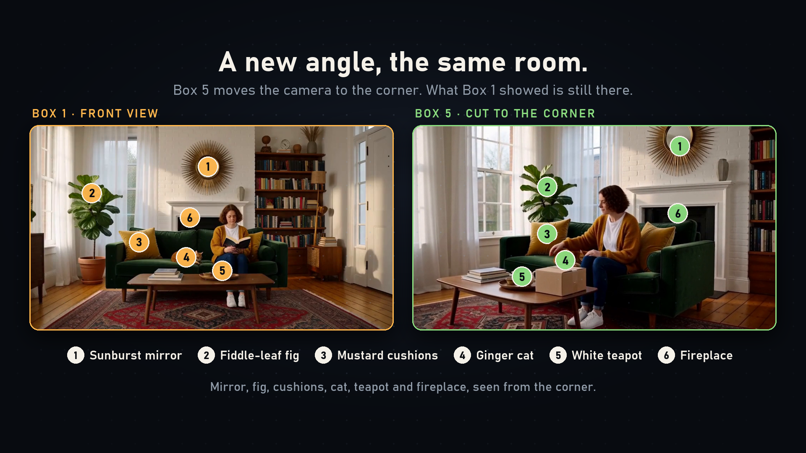

# H3 Continuity

H3 Continuity is a ComfyUI custom node pack for authoring and rendering sequences with MiniMax H3. Its Timeline organizes clips and carries context across continuing clips; the Studio adds story, reference and timeline editing. It also includes nodes for saved segments, stills and H3 context windows.

Visual memory can bring selected moments from earlier clips into a later shot, including after an exterior scene or a camera-angle change. H3 Story can plan and write the Timeline through an OpenAI-compatible endpoint, local or cloud.

[Watch the contest demo (under two minutes)](https://github.com/KadoBOT/ComfyUI-H3-Continuity-Studio/releases/download/v0.1.0/H3-Continuity-demo-contest.mp4) · [Full demo](https://github.com/KadoBOT/ComfyUI-H3-Continuity-Studio/releases/download/v0.1.0/H3-Continuity-demo-full.mp4) · [Reproduce the example](docs/MEMORY-DEMO.md)

## Installation

Install a current ComfyUI with working MiniMax H3 support and its model files. Clone this repository into `ComfyUI/custom_nodes/ComfyUI-H3-Continuity-Studio`, or extract the source archive there. Run `python -m pip install -r requirements.txt` from this folder using the same Python environment as ComfyUI. On Windows portable installations, use the portable installation's `python_embeded/python.exe` instead of a system Python.

Restart ComfyUI and load `examples/v1/01-hello-h3.json` (see First video below). A GPU and suitable model files are required for generation.

The Story writer requires a separately configured compatible language model endpoint. Models, provider services and their terms are separate from this node pack. Context Windows requires a ComfyUI version containing the core MiniMax H3 Context Windows node.

## First video

1. Start ComfyUI and open `examples/v1/01-hello-h3.json` (**Hello H3**) through its workflow loader. It needs no pictures, audio or language model.
2. In the five model loaders, select the H3 diffusion model, LoRA, text encoder, video VAE and audio VAE installed on your system. ComfyUI offers to download a missing text encoder or VAE from Comfy-Org/MiniMax-H3; select your own diffusion model and LoRA.
3. Click **▶ Render** on the H3 Timeline node. It renders both clips, the second continuing the first, and writes the full video under `output/h3_sequences/hello_h3`. Open the Studio and watch the join. The [guide](https://kadobot.github.io/ComfyUI-H3-Continuity-Studio/getting-started/first-sequence/) walks through each step.
4. Add features when you need them: the **H3 + References**, **H3 + Sound** and **H3 + Continuity tools** nodes, H3 Story and H3 Context Windows, each with a small example in `examples/v1/`. A new Timeline shows only what is connected; workflows saved before 1.0.0 open with every feature, as before.
5. Story is optional. To use it, configure a compatible language-model endpoint and model in the Story node. An external endpoint receives the story text and, when enabled, reference pictures. Check the provider's privacy and pricing terms.

Model names and paths in examples are illustrative; select files available in your own installation. ComfyUI and the chosen model determine the required hardware and software versions. H3 Continuity does not download model weights or provider credentials.

Avoid installing a second copy beside an existing H3 Continuity installation: both copies register the same nodes and routes. Back up projects before replacing an existing installation. Keep ComfyUI behind your usual authenticated access boundary if you expose it remotely.

## Documentation

The full user guide, with screenshots of every feature, is at **https://kadobot.github.io/ComfyUI-H3-Continuity-Studio/**. Its source is in [`guide/`](guide/).

Deeper reference notes: [Story Studio](docs/QWEN-STORY-STUDIO.md), [external Timeline](docs/EXTERNAL-TIMELINE.md), and [continuity checks](docs/CONTINUITY-CHECK.md). Generation quality and continuity vary with the model, inputs and settings; inspect the resulting joins.

## License and third-party material

Original project code is offered under the [MIT License](LICENSE). The public release does not include the optional MiniMax H3 prompt guides. If you have obtained them under terms that permit your use, place `base-en.txt` and `ref-en.txt` in `h3_continuity/h3_guide/` and restart ComfyUI. Without them, the node pack runs and its instruction bundle explicitly reports the missing guides. The guides and H3 model are subject to MiniMax terms, including territorial restrictions; see the [upstream project](https://github.com/MiniMax-AI/MiniMax-H3) and the included [notice](h3_continuity/h3_guide/NOTICE). Model weights and external dependencies have separate licenses. Review those terms before use or redistribution. See [third-party notices](THIRD_PARTY_NOTICES.md) for adapted guidance and attribution.
