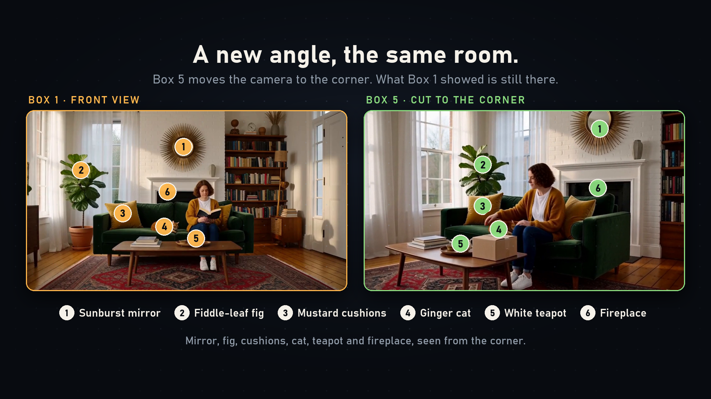

# Reproduce the memory demo

The [demo project](../examples/memory_demo.json) contains six boxes and one generated bridge. It needs no uploaded references, private project files or credentials. It includes the prompts, seeds, duration settings and selected memory moments used for the accepted demo.

1. A detailed living room establishes the sofa, cushions, cat, teapot, fireplace, mirror and fig.
2. A cut moves outside the house.
3. A bridge leads to another porch view, with selected visual memory of the clothes and door.
4. A cut returns inside, using selected moments from the first room box.
5. A cut changes to the room's corner view, also using selected moments from the first box.
6. A continuing reading shot carries Box 5's context. Its separate visual-memory setting is off: continuation already carries the preceding clip.

In Studio, paste the `timeline` object into the Timeline JSON control and apply the supplied `settings` on the Timeline node. Connect a working H3 rendering workflow, choose compatible installed models, and render in order. The supplied native prompts need no Story endpoint. For headless rendering, use the [Timeline API](TIMELINE-API.md): select a ready profile from capabilities and add its `profile` ID to this JSON when creating a fresh project. Keep receipt keys and accepted job IDs as described in that guide.

The example was rendered at 1024 x 576, 24 fps, with 39 carried context frames. Exact outputs depend on the H3 weights, sampler, LoRAs and runtime; fixed seeds do not guarantee identical output across configurations. The example is a demonstration of retained details, not a guarantee of perfect geometry or continuity. Review the generated result and use retakes where needed.

The contest edit preserves the complete main film at its original speed. The surrounding explanatory sections play 1.2x faster to meet the contest's two-minute limit. Its music was synthesized for the edit; the generated film retains its native sound. Original video and the contest cut are available on the repository's release page.

