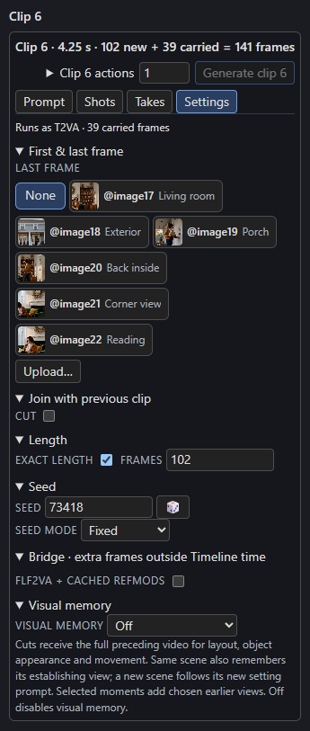

# Exact lengths and long edits

A **long edit** is a Timeline of many short cuts, each opening on its own picture, at exactly the lengths of a source edit (for example, a music video cut to a beat map).

H3 renders on its frame grid: `17k + 5` frames for a clip that starts fresh (at least 22) and `17k` new frames for a clip that continues the one before (at least 17). Without **Exact length** the Timeline snaps every clip to that grid, so a 9-frame cut becomes 22 frames and the edit drifts out of sync.

## Turn on Exact length

Open a clip's **Settings → Length** and tick **Exact length**. A **Frames** field then takes any length from 1 frame up to the clip's limit: **362** frames for a clip that starts fresh, or 362 minus the carried frames for one that continues.

[{ width=300 }](../assets/screens/exact-length.png)

The length reads like `0.38 s · 9 frames · H3 generates 22`. H3 generates the next grid length up, and the clip **keeps its first frames and drops the rest**:

| Plays | H3 generates | Dropped |
| --- | --- | --- |
| 9 (fresh) | 22 | 13 |
| 30 (fresh) | 39 | 9 |
| 96 (fresh) | 107 | 11 |
| 22 (fresh) | 22 | 0 |
| 40 (continuing) | 51 | 11 |

- Turning Exact length on keeps the clip's length; turning it off snaps the clip to the grid again.
- Dragging an exact clip's edge on the track moves it one frame at a time.
- A clip that drops frames gets a note when it renders, such as "Box 3 plays 9 frames; H3 generates 22 and drops the last 13."
- A cut opens on its first frame and, if it has a last frame guide, that guide lands on the last frame it *plays*: frame 9 of a 9-frame cut. A 1-frame cut shows only its first frame, so its last frame is not used.
- The saved video, its `_last.png` and its audio stop at the played length, while the saved latents keep every generated frame. The full video and its audio last exactly as long as the clips play.
- Clip starts, timed text, audio lanes, guides, memory, pins, the check and the writer's seconds all follow the **played** length.

## Cuts after dropped frames

A clip that continues the clip before replays that clip's last *generated* frames, so it **cannot follow a clip whose last frames were dropped**. After a clip that drops frames, the next clip must be a **Cut**, or there must be no next clip. Otherwise both clips show the problem and Render refuses with the same sentence, for example:

> Box 3 drops 9 generated frames, so box 4 can't continue it: make box 4 a cut, or give box 3 a length on the grid (22 or 39 frames).

A clip that continues also carries `context_frames` (39 by default) from the clip before, so a clip that plays fewer frames than that cannot be continued either. An exact length that sits on the grid drops nothing, so the next clip can continue it as before.

Changing an exact length makes the clip need a render again. Turning Exact length on for a clip that is already on the grid changes nothing.

## Many pictures

A long edit usually opens each cut on its own picture. Upload them on the **Pictures** page: they take slots from `@image17` up with no upper limit, and a clip still sends H3 at most **9** pictures. See [References and pictures](references.md).

## Building long edits from code

Set `"exact": true` on each box, stage each cut's pictures and bind them into saved slots from `image17` up. The [Timeline HTTP API](../automation/api.md) and the repository's External Timeline notes describe the fields and limits.
