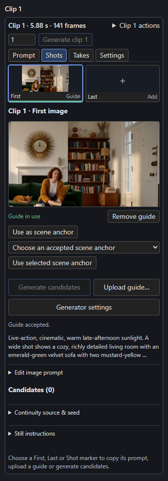
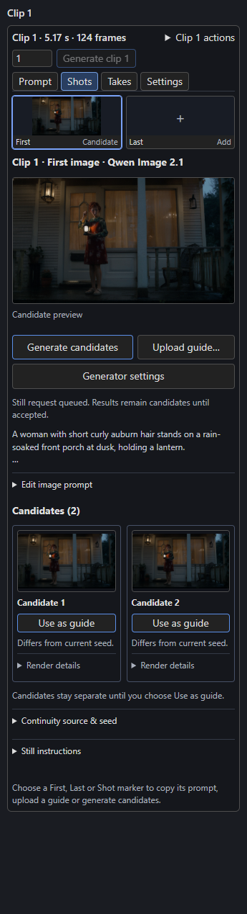
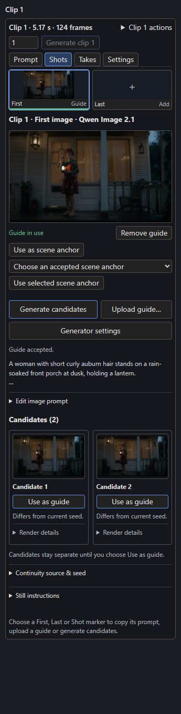

# First and last frames

A **guide** is a still image that pins part of a clip: its **First** frame, its **Last** frame, or a timed **Shot**. You can use a picture you already have, upload one, or generate candidates with a still generator and accept the one you like.

## Choose a picture you already have

In a clip's **Settings** tab, **First & last frame** lists every picture. Click one under **First frame** or **Last frame**, or choose **None**. **Upload…** adds a new picture and uses it in one step. See [References and pictures](references.md#pictures-saved-in-the-timeline).

## The Shots tab and the markers

Above the Timeline, every clip has a **First** and a **Last** marker, and a clip with several shots has one per shot. Click a marker (or press **Enter** or **Space** on it) to open its panel in the clip's **Shots** tab.

[{ align=right width=300 }](../assets/screens/frame-guide.png)

The panel offers:

| Control | Does |
| --- | --- |
| **Upload guide…** | Accepts a local image as this marker's guide. |
| **Generate candidates** | Asks the connected still generator for images (see below). Candidates stay candidates until you accept one. |
| **Generator settings** | Selects and centres the connected generator's node group in the graph so you can edit models, steps or sampler. |
| **Edit image prompt** | The still prompt, which explicitly describes a single opening frame (First, Shot) or the ending frame (Last). **Rebuild prompt** recomposes it from the scene text, instruction and extra details. |
| **Continuity source & seed** | Which video take or earlier accepted guide the new image should follow, and the **Image seed**. |
| **Still instructions** | The reusable instruction used for stills. |
| **Candidates (N)** | Each candidate keeps its prompt, exact seed and source. **Use as guide** assigns it; click a thumbnail for a large preview (**Esc** closes). |
| **Remove guide** | Removes the assignment. The image stays in your candidates. |
| **Split at guide** | On a **Shot** marker with an accepted guide: splits the clip there, so the guide becomes this clip's Last and a new clip's First. See [Split a clip at a Shot guide](#split-a-clip-at-a-shot-guide). |

After you accept a guide the panel reads **Guide in use**, and the marker above shows its thumbnail. A guide never changes a render until you accept it.

### Generating candidates

[{ align=left width=300 }](../assets/screens/still-candidates.png)
[{ align=right width=300 }](../assets/screens/still-guide-in-use.png)

The screenshots show two candidates the Qwen Image 2.1 example generated for a clip's First frame (about 40 s each on one RTX 5090 Laptop GPU), then the panel after **Use as guide** on one of them. The marker above the panel and the Timeline's **1 · First** marker now show the picture. The other candidate stays in the list until you remove it.

Still generation needs a **still recipe**: connect a native image-generator subgraph's `IMAGE` output to the **Still Recipe** node, and that node's output to the Timeline's `still_recipe` input. The example workflows include ready-made recipes:

| Example workflow | Image generator |
| --- | --- |
| `examples/h3_timeline_fizgig_still.json` and `examples/h3_fizgig_still.json` | H3 with the Fizgig still recipe (stock Ref2VA weights, 3872 × 2176, `er_sde`, 50 steps). |
| `examples/qwen_story_studio.json` | Qwen Image 2.1, the default base generator. |
| `examples/qwen_story_studio_turbo.json` | Qwen Image 2.1 Turbo, the faster alternative. |
| `examples/h3_story_studio_qwen_references.json` | H3 video with Qwen images attached. |

Select models you have installed; nothing is downloaded. Other pixel generators can be connected by declaring where their prompt, seed, size and reference inputs are. This is the **Still Recipe** node's `bindings` input; see the Qwen Story Studio notes in the repository for the schema.

!!! info "Which prompt is used"
    When you generate through the Timeline, the final prompt in the panel replaces the still subgraph's own prompt for that one request. The subgraph's prompt is used only when you run it standalone.

### Continuity between stills

- The **first accepted First image** becomes the scene anchor. Later requests receive that anchor, the preceding accepted guide (or a delivered video frame you choose) and the references the prompt mentions.
- **Use as scene anchor** promotes the current accepted image; **Choose an accepted scene anchor** then **Use selected scene anchor** reuses an anchor from another scene when you return to a place.
- A camera cut keeps the anchor; a new scene starts another one. Changing an anchor marks dependent candidates as out of date.
- Without a chosen video take, accept First first, then Shot and Last in order: each new candidate receives the preceding accepted guide.
- Continuity needs no extra models, but it cannot guarantee that the generator obeys it. Inspect every candidate.

### Prepare all still prompts

**Prepare all still prompts** (in the Timeline toolbar) uses the connected Story writer to write a richer still prompt for every First, Last and Shot target in one explicit batch. Edit **Still prompt conversion instructions** to steer it. Results describe subject and visible state, setting and layout, style and materials, lighting, colour palette, and camera and composition. Choose **Use prepared prompt** for one target or **Use prepared prompts for all targets** to apply them as one undoable step. Preparation is manual: when your clips or references change, **Still prompts are out of date** appears with a **Regenerate all still prompts** action; image generation never calls the converter by itself.

## How guides meet neighbouring clips

- On an unrendered **Continue** join, accepting clip B's First image assigns the same image to clip A's Last and clip B's First.
- If either neighbour has rendered material, accepting a replacement at B's First sets B to **Cut** and leaves A alone.
- When a verified saved predecessor ending exists, the First panel offers **Use saved predecessor ending**, which reuses that exact ending and restores **Continue**.
- Last targets the last *delivered* frame, including [exact-length](exact-lengths.md) trimming. Guides can use individual frames, not just the 17-frame grid.

## Split a clip at a Shot guide

A guide on a **Shot** marker steers one frame in the middle of a generation; H3 blends the video toward it and away again. **Split at guide** turns the guide into a real endpoint instead, so one clip ends exactly on the image and the next starts from it. In testing the video looked about as smooth either way; the split gives you a hard boundary, the native First/Last path and two separately editable clips:

- The clip now ends on the guide (its **Last**), and a new clip continues from it (its **First**) with a **Continue** join, so motion and sound carry through.
- Both clips are rounded up to H3's frame grid, so no performance time is lost. The guide can land a few frames later; the button's tooltip and the note after the split give the lengths and the time added. An [exact-length](exact-lengths.md) clip keeps its second half exact.
- **Prompt.** A guide on a shot's start splits before that shot. A guide inside a shot (an older saved guide with only a frame) keeps that shot's text in both clips, so edit the first to end at the guide and the second to start from it. Later timestamps are re-based to the new clip.
- **References.** A half that still mentions references gets **FLF2VA + cached RefMods**, so the references don't turn it back into REF2VA. This needs H3's VAE loaded from a file (**VAELoader**). A half with raw audio or video references, or a fresh half with references but no First, still runs as REF2VA; the note after the split names it.
- The new clip gets a new seed. Other guides, plate changes, pinned cast moments and chosen memories after the guide move to it. Earlier takes stay in `takes/`, and both clips render again.
- The split is one undo step. It is refused for a guide at the clip's First or Last frame, when the first clip would be shorter than the frames the next clip carries from it, or when either half would pass the clip limit.

An older guide that has no marker offers the same button in the **Shots** tab's list of saved stills.

## Optional reusable images for Cast

The **Prepare references** section on the [Cast page](../story/cast.md) creates reviewable candidates for characters, scheduled appearances, locations and props before you generate First, Last or Shot images. The three generation switches start off and are independent.

!!! warning "Experimental geometry"
    Reference delivery does not establish exact reconstructed geometry. The Qwen presets only partly followed a requested 45° camera change in testing, so treat arbitrary-view geometry as experimental and accept only candidates you have inspected.
