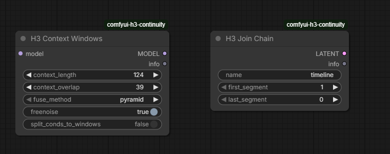

# Long clips with context windows

H3 samples a clip in one pass, which limits how long a single clip can be. ComfyUI's **MiniMax H3 Context Windows** (ComfyUI pull request 17425, merged 2026-10-30) samples a long audio and video latent in **overlapping windows**, keeps audio in step with video, crops first and last frame guides to each window and applies references per window. H3 Continuity builds three things on top of it.

!!! warning "Status"
    These features are implemented and unit-tested on CPU, and were checked on one GPU setup (below). They need a ComfyUI version that includes the core Context Windows node; otherwise the nodes say so. Update ComfyUI before using any of this.

## The H3 Context Windows node

Place **H3 Context Windows** between the model and the sampler.

| Input | Meaning |
| --- | --- |
| `context_length` | Frames sampled together in one window, snapped to `17k + 5`. Default 124. |
| `context_overlap` | Frames shared by neighbouring windows, snapped to `17k + 5` and kept shorter than the window. Default 39, the Timeline's default carried context. |
| `fuse_method` | How overlapping windows are blended (`pyramid` by default). |
| `freenoise` | Shuffle noise per window so neighbours blend better. |
| `split_conds_to_windows` | Split conditioning across windows. |

## Raising the clip limit

The default maximum is **362** generated frames. A Timeline may set `"max_frames"` (a `17k + 5` value from 362 to 991) in its JSON to allow longer clips: a clip of up to that many generated frames when fresh, minus the carried frames when continuing. A clip over 362 frames gets a note telling you to connect H3 Context Windows, because without windows the sampler would try all of it at once.

!!! note "Studio limit"
    The Studio keeps a Timeline's `max_frames` and lets clips reach it, but has no control to set it, and the Story planner still stops at 362. Set `max_frames` in the Timeline JSON or through the [API](../automation/api.md). `limits.max_frames` in the prepare bundle reports the range.

## Removing seams

`long_merge.merge_continuing(timeline_json, first_id, last_id)` turns a run of continuing clips into one clip: frames add up (still `17k + 5`), prompts join in order, and previews and plate changes move by the frames before them. Cuts, Exact-length clips and a continuing clip with a first frame are refused. Windowed sampling then blends the old seams. Nothing calls it automatically.

## Refining a rendered chain

**H3 Join Chain** reads saved segments `first_segment`..`last_segment` of one continuing chain from `output/h3_sequences/<name>` and joins them into a single latent, keeping each carried stretch once (`0` joins through the last saved segment). Noise it with a sampler `denoise` below 1 and sample it through H3 Context Windows. A chain that crosses a cut, or a segment that dropped frames, is refused. The refined latent is **not yet saved back as segments**.

## What was measured

One RTX 5090 Laptop run at 640 × 384 with an FL2VA int8 model and an 8-step turbo LoRA, windows of 124 frames overlapping 39:

| Run | Result |
| --- | --- |
| 243-frame clip with first and last guides, windowed | 130 s; guides landed; no hard cut (largest frame-to-frame change 5.2, against 2.8 without windows). Slightly busier motion than unwindowed. |
| Same, guides unrelated to the prompt | The first and last windows follow their guide; the middle windows follow only the prompt, so the video cuts to the prompt's scene and back. Guides anchor only the window they fall in. |
| 498-frame clip, `max_frames` 498, first and last guides | 205 s, 20.75 s of video with audio; no hard cut; both guides land. |
| `@image1` reference clip, 243 frames, windowed | The same woman and outfit in every window; no hard cut. |
| Two continuing clips merged to 226 frames, **Join Chain**, denoise 0.45 | 105 s; the join spike was gone; motion slightly busier. |

A sweep of window settings (overlap, window length, `freenoise`, `fuse_method`) found no setting that was clearly better, so the defaults stay. Every windowed run was busier than the unwindowed control, so the extra motion comes from windowing itself.

**Not verified:** memory blocks with windows, a last-frame guide on a clip that drops frames, clips past 498 frames, higher resolutions and VRAM peaks. These results were judged from frame statistics and contact sheets; nobody has watched the clips, so judge the motion yourself.
