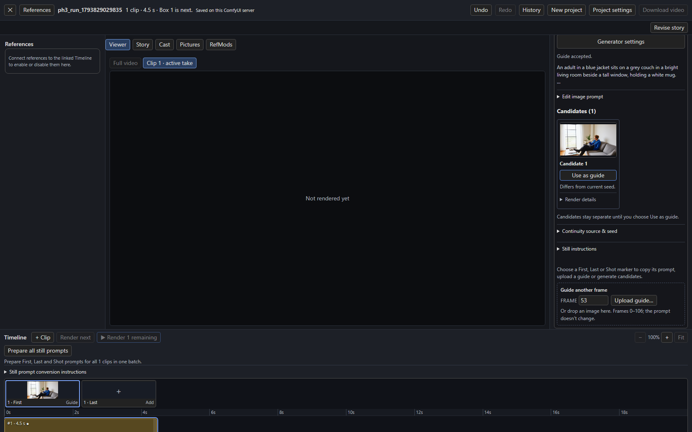
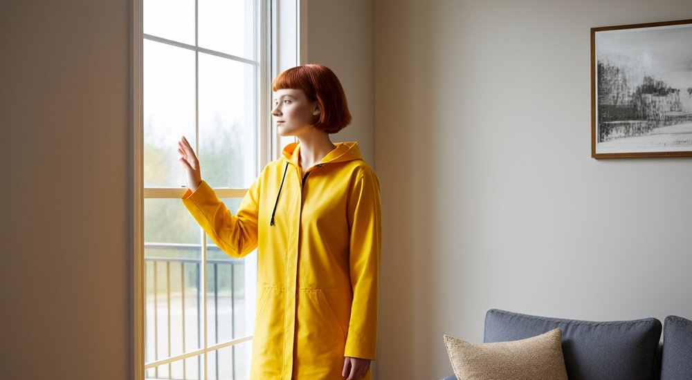

# Stills with P-H3-Image

**P-H3-Image** is an image model by Pruna AI, derived from MiniMax H3. The **P-H3-Image Still** node (in the H3 Continuity category) wraps its official ComfyUI workflow in one node, so you can generate [First, Last and Shot guides](frame-guides.md) without building a sampler graph or writing a recipe. (It is not Pika Labs' H3 video work.)

!!! warning "License"
    The weights are under the [MiniMax H3 Community License](https://huggingface.co/PrunaAI/P-H3-Image-Comfy/blob/main/LICENSE). Among other terms it excludes the European Union, the United Kingdom, the Republic of Korea and the United States unless you have a separate license from MiniMax, and products built on it must show "Powered by MiniMax H3". Read it before use.

## Install

1. **ComfyUI 0.44.0 or newer.** P-H3-Image is native in ComfyUI (`PH3ImageConditioning` and `ModelSamplingMiniMaxH3`), with no extra custom nodes. If the nodes are missing, the P-H3-Image Still node says which core nodes it could not find.
2. **Download one file per component** from [PrunaAI/P-H3-Image-Comfy](https://huggingface.co/PrunaAI/P-H3-Image-Comfy) into `ComfyUI/models`. Files of different precisions can be mixed.

    | Component | Folder | bf16 | int8 (`int8_convrot`) | w4a8 |
    | --- | --- | --- | --- | --- |
    | Diffusion model | `diffusion_models/` | 40.5 GB | 21.2 GB | 13.4 GB |
    | Text encoder | `text_encoders/` | 9.1 GB | 5.1 GB | 3.6 GB |
    | VAE | `vae/` | 5.6 GB | 3.1 GB | none |
    | Prompt upsampler (optional) | `text_encoders/` | 19.3 GB | 9.7 GB | 6.7 GB |

    The smallest set (w4a8 model and text encoder, int8 VAE) is a 20 GB download and peaks near 21 GB of VRAM at 8 megapixels; the int8 set peaks near 31 GB and the bf16 set near 56 GB. ComfyUI offloads what does not fit. For example, for the smallest set:

    ```bash
    hf download PrunaAI/P-H3-Image-Comfy --include "diffusion_models/p-h3-image_w4a8.safetensors" "text_encoders/p-h3-image_text_encoder_w4a8.safetensors" "vae/p-h3-image_vae_int8_convrot.safetensors" --local-dir ComfyUI/models
    ```

    Folders listed in `extra_model_paths.yaml` work too. The video H3 weights and VAEs are different files and are not interchangeable.
3. **Restart ComfyUI**, then reload the browser.

## Connect it

Load `examples/ph3_image_story_studio.json` (Story, Timeline and the P-H3-Image Still node, already wired), or add the node yourself:

1. Add **P-H3-Image Still**. Select the installed `diffusion_model`, `text_encoder` and `vae`. The lists show only files whose names start with `p-h3-image`, found through ComfyUI's normal model folders.
2. Connect its **still_recipe** output to the Timeline's `still_recipe` input. There are no bindings to edit.
3. Open the Studio, select a **First**, **Last** or **Shot** marker and press **Generate candidates**. The result is an ordinary candidate; **Use as guide** applies it.

The node's own prompt, seed, width and height are filled in by the Studio for each request. Its **image** output can feed a Save or Preview node if you want to test it alone.

[{ width=480 }](../assets/screens/ph3-image-guide-applied.png)

## What it does with your clip

- **First, with no references:** plain text to image from the still prompt, at the size and seed the Studio shows.
- **With references** (an accepted scene anchor, the previous guide, Cast pictures): they are passed as `<Picture 1>`, `<Picture 2>` and so on, up to 8. The Studio puts the scene or location first, because P-H3-Image treats `<Picture 1>` as the image it edits, and writes each picture's role into the prompt (`Edit <Picture 1>. …`). Candidates show the executed prompt and reference roles under **Render details**.
- **Sizes** must be multiples of 32, as everywhere in the Studio. Text to image is best near 8 megapixels and edits near 4 or 8; smaller stills work, and the examples here were rendered at 1024 × 576 and 1280 × 704.
- **Prompt upsampler** is off by default. The Studio's *Prepare all still prompts* already writes long prompts, and the upsampler adds a model load. Select an upsampler file in the node to expand short prompts instead; it is not available together with reference images yet.

Story and **Prepare all still prompts** tailor their image instructions to P-H3-Image when this node is selected, including through the still-generator switch. Prepared prompts name the requested image medium, describe one concrete instant with framing and directional light, and make reference edits explicit about what stays and changes. They avoid hype words and excessive length, and quote exact requested lettering. Saved prose keeps logical `@imageN` references; the Studio assigns `<Picture N>` labels at generation time. The still converter uses this guidance even when Story also writes H3 video. Existing saved prompts and edited conversion instructions stay editable; regenerate prepared prompts to use the new guidance.

These instructions follow Pruna's [P-H3-Image prompting and editing guide](https://huggingface.co/PrunaAI/P-H3-Image#prompting).

[{ width=480 }](../assets/screens/ph3-image-references.jpg)

The picture above came from two reference pictures, a living room as `<Picture 1>` and a portrait as `<Picture 2>`, and the prompt "the young woman from Picture 2 stands by the window". It kept the room's window, couch and framed picture and the person's hair and coat. As with other generators, inspect each candidate; references guide the image but do not guarantee geometry.

## Checks and messages

Nothing is checked when the Timeline renders a video: a still generator that is not asked for never runs and never loads a model. When a still is requested, the node checks before loading anything and says what to fix:

| Problem | Message names |
| --- | --- |
| A component file is missing | the component, the folder, an example file name and the Hugging Face repository |
| The selected file is not a `p-h3-image` file | the installed files you can choose |
| ComfyUI too old | the missing core nodes and the version to update to |
| Width or height not a multiple of 32, or under 256 | the value |
| More than 8 reference pictures | how many were sent |

## Other generators

P-H3-Image Still is one ready-made generator. Qwen Image and any other native graph still connect through the **Still Recipe** node, as described in [First and last frames](frame-guides.md#generating-candidates).
