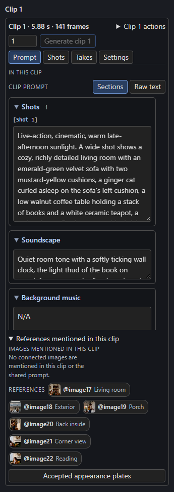
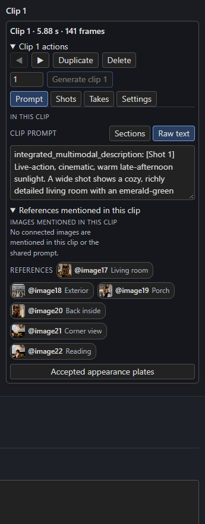

# Writing prompts

Each clip has its own prompt. Open a clip and use the **Prompt** tab in the right-hand panel.

[{ align=right width=280 }](../assets/screens/clip-prompt.png)

## Sections or raw text

**Sections** splits H3's structured prompt into labelled boxes you can edit one at a time:

- **Shots**: the visible action, with one `[Shot N]` entry per distinct stage or view.
- **Soundscape**: sound in the scene (the prompt's `overall_soundscape`).
- **Background music**: audience-only music, or `N/A` (the prompt's `non_diegetic_music`).
- For reference-based clips, **Subjects & references**, **Summary** and **Reference retention** also appear.

**Raw text** shows the whole prompt as one text field, for pasting in a prompt you wrote elsewhere or for edits that cross sections. Both views edit the same text, and native H3 prompts are accepted directly: the Story writer is optional.

[{ width=280 }](../assets/screens/clip-prompt-raw.png)

!!! tip "Native H3 prompt structure"
    The demo project's prompts are written in H3's structured style: an `integrated_multimodal_description:` with one or more `[Shot N]` stages, then `overall_soundscape:` and `non_diegetic_music:`. Dialogue goes in `<d>…</d>`. If the optional MiniMax guides are installed, the Timeline's instruction bundle carries them; otherwise follow the official MiniMax H3 documentation.

## Mention references with `@`

Refer to a connected or uploaded reference in the prompt as `@image1`, `@video1`, `@video_audio1` or `@audio1`; the placeholder in an empty prompt reminds you. Under **References mentioned in this clip**, every reference appears as a chip with its thumbnail and name. Click a chip to insert its mention at the cursor.

Mentions turn into H3's native reference tags when the clip is prepared. A reference that is **disabled** (or not connected) is not sent to H3, and its mentions read as a plain description of the subject or sound instead of a reference. See [References and pictures](references.md).

## The shared prompt

**Project settings → Shared prompt** is text added before every clip's prompt: a place to say the style, the setting, or who `@image1` is once. It applies to every clip, including any bridge.

## Effective prompt

Under the Prompt tab, **Effective H3 prompt and text window** (when [timed text](../sound/timed-text.md) is attached) shows the final prompt with references rewritten and the projected lettering window. For still guides, **H3 conditioning prompt** under a candidate shows exactly what the still generator received. Use these to check what the model will actually see.

## Shots inside a clip

A clip can hold several `[Shot N]` stages, each with its own timing. A single simple action needs only one. **Split before Shot N** (on the **Shots** tab) turns a shot boundary into two clips. The Story writer prefers **short, independently editable clips**, even for a continuous take; for example a 15 s take might be written as 2 + 3 + 4 + 4 + 2 s clips that each continue the last. This is a default, not a rule. You can draw clips of any length.

## Writing for continuity

- Name the camera move and its speed when it matters. Quiet holds and static framing are valid.
- Give each distinct action its own `[Shot N]` so it gets its own time.
- For a **Continue** clip, start from the pose and motion the previous clip actually ended in. The Timeline carries the previous latent, and also uses the previous clip's saved last image as a guide at the first new frame so the pose does not reset.
- Keep adjacent stages mechanically compatible: a turn, a gaze change or a step needs playable time.

!!! warning "Text cannot guarantee pixels"
    For exact prop counts or strict start and end poses, inspect and accept first and last [frame guides](frame-guides.md) before rendering. A matching first frame alone does not establish smooth motion in the frames after it.
