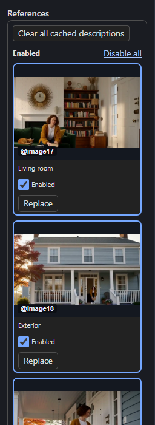
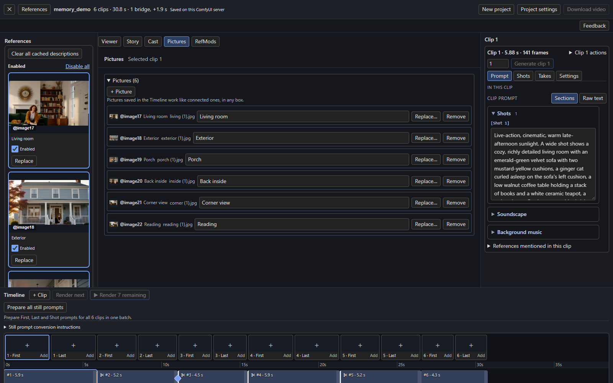

# References and pictures

H3 Timeline accepts the same reference media groups as ComfyUI's native **MiniMax H3 Reference to Video** node, and adds pictures that live inside the Timeline itself.

## Connected references

| Timeline input | Native input | Mention in a prompt | Meaning |
| --- | --- | --- | --- |
| `images.imageN` | `ref_images` | `@imageN` | Image reference; up to 9 are selected per clip. |
| `videos.video1`–`video3` | `ref_videos` | `@video1` | A video's frames, at 24 fps. |
| `video_audios.video_audio1`–`3` | `ref_video_audios` | `@video_audio1` | The soundtrack paired with the same-numbered video. |
| `audios.audio1`–`audio3` | `ref_audios` | `@audio1` | A standalone audio reference. |

Connect a video loader's frame batch to `video1` and its audio to `video_audio1`. A loader that returns a ComfyUI `VIDEO` object needs **Get Video Components** first to obtain the `IMAGE` frames and `AUDIO`. Supply frames at 24 fps, as the native node requires.

### One long video across clips

To repaint or restyle a long video clip by clip, connect the whole video to `video1` and tick **Split @video1 across clips** under **Project settings → Long continuing chains** (in the Timeline JSON: `"video_slices": ["video1"]`). Each clip then receives only its own part of the video: from the clip's start in the Timeline minus the frames it carries from the clip before, for every frame H3 generates for it, so the reference and the carried overlap line up. Its same-numbered soundtrack (`video_audio1`) is cut the same way. Mention `@video1` in each clip's prompt as usual. A video too short for a clip stops that clip with how many frames it has and which it needs.

The Timeline also exposes `IMAGE` outputs `image_1`, `image_2`… that match the selected clip's final native `<Picture 1>`, `<Picture 2>` order, including uploaded pictures, replacements and accepted guides. They are useful for feeding a still generator or an upscaler.

## The References pane

The Studio's left column lists every reference with its `@imageN` name.

[{ align=right width=200 }](../assets/screens/references-panel.png)

- **Enabled** references are above **Disabled** ones. Use **Disable all** or **Enable all**.
- Click a thumbnail to preview it. Each reference has an **Enabled** switch and **Replace**.
- **Replace** swaps in any available reference of the same type, including disabled ones. Prompt mentions, frame assignments and Cast picture choices follow the swap, and the whole switch undoes and redoes.
- **Clear all cached descriptions** forgets the writer's cached descriptions of your pictures.
- Hide the pane with the top bar's **References** button when you want the full width.

## Pictures saved in the Timeline

Wired inputs need a Load Image node. For most work, upload pictures into the Timeline instead.

1. Open **Pictures** (centre tabs) and press **+ Picture**. Pick one or more files.
2. They take the next free slots from `@image17` up, after the node's 16 wired inputs, in file-name order, with no upper limit.
3. Give each a **Title**. It replaces the file name everywhere, and the Story writer uses it as the reference's name.

Use them exactly like connected pictures: mention them in any prompt, choose them as a clip's first or last frame, give them to [Cast](../story/cast.md) entities and looks. Enabled references can turn them off, and with more than 12 pictures the pickers show a **Filter pictures** field.

| Action | Result |
| --- | --- |
| **Replace…** | Uploads another file into the same slot and keeps its title. Every mention and frame shows the new file; clips that use it need a render again. |
| **Remove** | Takes the picture out at once and names the clips that used it. Their mentions show as missing. **Undo** brings it back. |
| **Upload…** under a clip's First or Last frame | Adds a picture and makes it that clip's frame in one step. |
| **Upload…** in Cast | Adds a picture and uses it in the same Cast edit. If the edit fails, the picture is taken out again. |

A new picture never takes a slot the Timeline still names. When a clip renders, only the pictures that clip uses are loaded, with ComfyUI's own Load Image code, so a Timeline picture renders exactly like the same file on a wired node. A clip that uses a picture whose file is gone stops with a message naming the clip, the picture and the file; a picture no clip uses never stops a render.

!!! note "Where files live"
    Uploaded pictures are stored in ComfyUI's `input/h3_pictures`; uploading the same file again reuses it. Exports keep file references rather than embedding the images, so moving a Timeline to another computer needs those files, just as it does for wired pictures.

## RefMods

RefMods are references saved as encoded H3 conditioning rather than as pixels. They need the companion **ComfyUI-MiniMaxH3Mod** pack and take their own slots. A Timeline picture cannot occupy a RefMod's slot.
