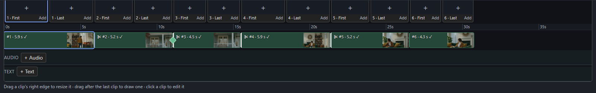
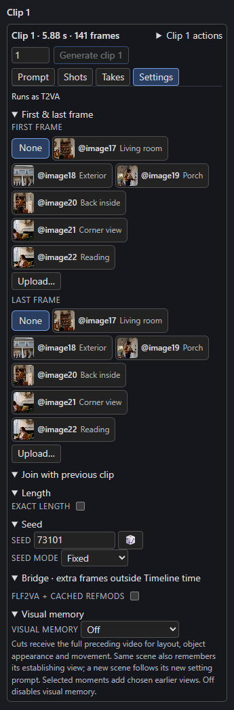

# Timeline and clips

The Timeline is a list of **clips**. Each clip is one H3 generation with its own prompt, seed, length and join. The strip along the bottom of the Studio is where you arrange them.

## Add, resize and arrange

| To | Do this |
| --- | --- |
| Add a clip | **+ Clip** in the Timeline toolbar, or drag after the last clip on the track to draw one. |
| Resize a clip | Drag its right edge. Lengths snap to H3's frame grid (see below), unless the clip uses [Exact length](exact-lengths.md). |
| Select a clip | Click it. The right-hand panel and the Viewer follow. |
| Move, copy or delete | **Clip N actions** in the panel: move earlier or later, **Duplicate** (the copy gets a new seed) or **Delete**. |
| Split a clip | A clip whose prompt has more than one `[Shot N]` offers **Split before Shot N** in its **Shots** tab. Later shots need increasing `At MM:SS.mmm,` timestamps. The split separates the shots into two clips, with the second starting as a **Cut**; each half keeps the references it uses and accepted guides move with their shots. A bridge before the clip stays with the first half. Frame guides do not offer a separate split action. |

!!! info "H3's frame grid"
    H3 generates at 24 fps, in lengths of `17k + 5` frames for a clip that starts fresh (at least 22) and `17k` new frames for a clip that continues the one before (at least 17). Without Exact length, every clip snaps to that grid. The default maximum is 362 frames; see [Long clips](long-clips.md) to raise it.

## Join with the previous clip

Open a clip's **Settings** tab.

[{ align=right width=280 }](../assets/screens/clip-settings.png)

- **Continue** (both **Cut** and **New scene** off): the clip carries the previous clip's last frames, `context_frames` of them, as native H3 context, so motion and sound continue.
- **Cut**: a new camera angle in the same place. No frames are carried, but with [visual memory](../continuity/visual-memory.md) the clip can still remember the scene.
- **New scene**: a cut to a different place, time or look. It starts a new scene for visual memory.
- On a Timeline with a [Story bible](../story/cast.md), a **Join** selector (Continue, Transition, Cut, New scene) replaces the two switches.

A **bridge** is a generated move between two rendered clips; see [Joins and bridges](../continuity/joins-and-bridges.md).

## The Settings tab, section by section

**First & last frame**
:   Pick a picture as the clip's first or last frame, or **Upload…** one. See [First and last frames](frame-guides.md).

**Join with previous clip**
:   The **Cut** and **New scene** switches described above.

**Length**
:   The clip's length, with the **Exact length** switch for [frame-exact edits](exact-lengths.md).

**Seed**
:   The clip's seed, a button for a new random seed, and a **Seed mode**. The seed belongs to the clip, so changing it renders only that clip again.

**Bridge**
:   **Insert bridge** (extra frames outside Timeline time) or **Replace around the cut** (a reviewed region regenerated within it, unavailable for now), shown on a join that cuts. See [Joins and bridges](../continuity/joins-and-bridges.md#bridges).

**FLF2VA + cached RefMods**
:   An experimental per-clip switch that converts first, last and reference images into reusable RefMods. It is off by default. Use it only with the matching example workflow.

    A clip that runs as REF2VA shows **Convert to FLF2VA** under its mode line. The button turns this switch on: the clip's First and Last frames, and accepted guides at those frames, become its start and end frames, and the images it mentions become cached image RefMods. The button is disabled, with the reason beside it, when the clip cannot convert:

    - **Raw video** (`@video1`, `@video_audio1`): the Studio cannot convert a video to a RefMod. Create a video RefMod with RefForge's **Create H3 RefMod** node, assign it on the **RefMods** page, and mention that slot instead.
    - **Raw audio** (`@audio1`, or an audio clip in the audio lane under this clip): create an audio RefMod with RefForge and assign it to the same slot on the **RefMods** page.
    - **No First frame** on a fresh clip: choose one under **First & last frame** or accept a First guide.

**Visual memory**
:   Which earlier moments this clip is shown. See [Visual memory](../continuity/visual-memory.md).

## Rendering

| Button | Renders |
| --- | --- |
| **Render next** | The next clip that is not current, or once every clip is current, the next [bridge](../continuity/joins-and-bridges.md#bridges). |
| **▶ Render N remaining** | Every clip that is not current, in Timeline order, then every bridge that needs a render. |
| **Generate clip N** | Only that clip. The number beside it sets how many [takes](../continuity/takes.md) to render (1 to 10), each with a new seed. |

ComfyUI's **Run** button also works: each queued run renders the next clip that needs it.

A clip is **current** when its saved render still matches its prompt, seed, length, join, pictures, memory and the node's settings. Change any of those and the clip needs a render again; the Timeline says why when you point at it. A clip that **continues** another also needs a render when the clip before it renders again.

!!! tip "Re-rendering one clip"
    **Generate clip N** renders only that clip, with its saved neighbours as anchors. Re-rendering can put later clips that continue it, or remember frames from it, out of date; the Timeline marks them and says why, and nothing renders again until you ask.

## Where files go

Renders are written to `output/h3_sequences/<name>/`: one MP4, one latent file (`.safetensors`) and a last-frame PNG per clip, a manifest, the full video, and a `takes/` folder for earlier renders. Keep the folder together; the latents are what let a later clip continue exactly.

## Status you can read

The head of the Studio reads like **6 clips · 30.8 s · 1 bridge, +1.9 s · All 6 boxes are rendered.** The *+1.9 s* is the time inserted bridges add to the *full video only*; the Timeline's own time, audio lanes and timed text do not include it. [Replacements](../continuity/joins-and-bridges.md#replacement-bridges) are counted after it, for example *· 2 replacements*, and add no time.
