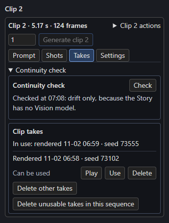
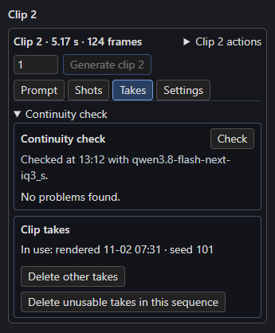

# The continuity check

After rendering, the Story's **Vision model** can check each rendered clip against the [Story bible](../story/cast.md), its pictures and the clip before it, and every check measures how far the clip's colours drifted. **The check only reads the renders.** Nothing renders again unless you press **Retake**.

## Check and Check all

In the Studio, the **Takes** tab of a rendered clip shows **Continuity check**. 

[{ align=right width=300 }](../assets/screens/check.png)

- **Check** checks that clip, even when it has a current result.
- **Check all rendered clips**, on the Story node and the Story page, checks every rendered clip without a current result, in Timeline order, with one load of the model.
- Both need a linked **H3 Story** node. Progress shows in the Story panel, and **Cancel** stops the check and keeps the clips it finished.

The Vision model is the Story's `vision_model`, at `vision_base_url` (or `base_url` when that is empty), with the Story's `thinking`. For each clip it receives:

- **Frames of the render**: the middle of each shot (after any frames replayed from the clip before), then the last frame. More than 5 shots give 5, evenly chosen. A clip whose source has no shots gives 3 evenly spaced frames. Each frame is labelled with its shot and time.
- The **pictures of the clip's scheduled characters, props and place** as the look in force there has them, with the bible's wording.
- The **join**, its note and, unless the clip starts a new scene, the previous clip's last frame and how it ended.

It reports only differences a viewer would notice: a character, prop or place that doesn't match its pictures or wording, or a join that doesn't match the clip before. Camera moves, framing, motion, blur and artefacts are not reported.

## Reading the result

[{ align=right width=300 }](../assets/screens/check-vision.png)

The first line says where the clip stands: *Not checked yet.*, *Checked at 10:42 with vision-8b.* or *The last check was of an earlier render.* Below it, problems are grouped under the clip's characters and props by name, then **Place** and **Join**, with the shot where it shows when the model names one, such as *Her hood is down (shot 2).* *No problems found.* (as in the second screenshot, from a Vision model running locally) means the model found none; *The check couldn't read the Vision model's answer.* means its reply didn't fit, so press **Check** again.

**Retake** shows when the check found problems, drift or an unreadable answer. It is the clip's **Generate clip N** with a new seed: it renders that clip alone, and the old render moves to `takes/` where you can [play it and put it back](takes.md). Clips that continue from it keep their renders.

### Drift

**Drift** compares the clip's colour with its scene's first clip (the nearest clip at or before it that cuts to a new scene, or clip 1). The colour is the mean in CIELAB of the frames the check looks at. A shift of 8 or more on the a\*b\* plane names its larger direction (warmer or cooler, redder or greener); a change of 10 or more in L\* reads as a percentage of the first clip's lightness. Together they read like *Drift: warmer and 12% darker than box 1.* Below both steps there is no drift line.

## Without a Vision model

With no `vision_model`, Check and Check all measure **drift only**, and the panel says so: *Checked at 07:08: drift only, because the Story has no Vision model.* (the first screenshot above). Once the Story has a Vision model, **Check all** checks those clips again.

## When a result is current

Results are saved in `checks.json` in the sequence folder, one per clip, with the render each was made for. Rendering the clip again (including Retake) makes its result stale: *The last check was of an earlier render.* Deleting `checks.json` forgets every result. A Timeline nobody checks has no `checks.json`.

## The queue and the GPU

A render that is running or waiting could replace the clips being checked and would share the GPU with the Vision model, so the check starts only when ComfyUI's queue is empty: *ComfyUI is rendering or has prompts waiting. Check when its queue is empty.* It does not start while a Write or another check runs, and while it runs Write says *A continuity check is running. Cancel it or wait.*

With `free_vram` on and the Vision model on this PC, the check takes a turn in ComfyUI's queue as Write does, and after the last clip the Story unloads the Vision model once (also after Cancel).
