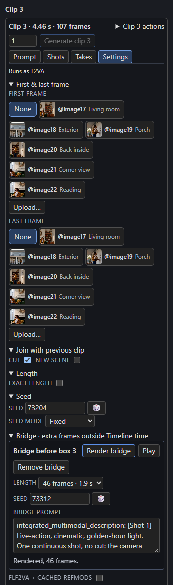

# Joins and bridges

Every clip after the first says how it meets the clip before it.

## The join types

| Join | How to set it | What H3 gets |
| --- | --- | --- |
| **Continue** | **Cut** and **New scene** both off. | The previous clip's last `context_frames` frames and, with `carry_audio`, its matching audio, frozen as native context. Motion and sound carry on. A continuing clip also uses the previous clip's saved last image as a guide at its first new frame so the pose does not reset. |
| **Cut** | Tick **Cut** in **Settings → Join with previous clip**. | No carried frames: a new camera angle. With [visual memory](visual-memory.md), people, clothes and place can still hold. |
| **New scene** | Tick **New scene**. | A cut to a new place, time or look. Visual memory keeps its history while the new prompt defines the new setting. |
| **Transition** | Available through the [Story bible](../story/cast.md)'s **Join** selector (Continue, Transition, Cut, New scene, with an optional note). | A scene-driven transition generated *inside* H3 that grows out of the scene. It writes the same flags, so rendering is unchanged. |
| **Bridge** | **Insert bridge** on a clip that cuts. | Generated frames on the join, which add time. Regenerating a reviewed region within the video's length instead is [unavailable for now](#replacement-bridges). See below. |

Story planning chooses between seamless continuation, an in-scene transition and a hard cut according to your story, rhythm and Guide. **Existing Timeline boundaries and Cut flags remain authoritative**: Story never overrides a join you set.

## Bridges

A **bridge** turns the hard cut between two *rendered* clips into a generated move. **Neither clip renders again**, and every clip keeps its render and its Timeline time. A bridge has one of two modes:

| Mode | What H3 renders | Use it when |
| --- | --- | --- |
| **Insert time** | New frames between the two clips. The full video gets longer. | Nothing under the cut has to stay in sync with the picture. |
| **Replace around the cut** | A region you confirm, the end of the clip before and the start of the clip after, regenerated with exactly as many frames. The video keeps its length and every recording stays in place. | Unavailable for now: generated candidates still jump at their joins. See [Replacement bridges](#replacement-bridges). |

### Insert one

Select a clip after clip 1 that starts with **Cut** or **New scene**, and open **Settings → Bridge**.

[{ align=right width=300 }](../assets/screens/bridge.png)

**Insert bridge** is on when this clip and the one before it are rendered, and the one before plays every frame it generates. Otherwise it is off, and the line underneath says why, for example "Render box 3 first." or, after an exact clip that drops frames, "Box 3 drops 9 frames, so the bridge before box 4 can't start from its last frame: use a replacement bridge, or give box 3 a length on the grid, which moves every later box." While a recording is [locked to the sequence clock](../sound/dialogue.md#lock-a-recording), **Insert bridge** is off and the join stays a cut: *A locked recording keeps its place, so this join stays a cut: a bridge would add time, and replacement bridges are unavailable.*

A new bridge has 29 frames, a new seed and a copy of the clip's prompt. Its panel has:

- A **mode** selector: **Insert time** or **Replace around the cut**, which is off while replacements are unavailable. Switching keeps the length; switching back to Insert time drops the confirmed region and any selected candidate.
- **Length**: 12, 29 or 46 new frames, with their seconds.
- **Seed**, with a button for a new one.
- **Bridge prompt**: how the shot moves from the clip before into this one.
- **Render bridge**, **Play** and **Remove bridge**.
- A line with the bridge's state.

A small **diamond** on the join, in the bridge's state colour, opens the bridge when clicked. The status line adds bridges and the time they add, for example *6 clips · 30.8 s · 1 bridge, +1.9 s*. Replacements are counted separately and add no time: *6 clips · 30.8 s · 1 bridge, +1.9 s · 2 replacements*.

### What H3 renders

An insertion bridge run carries the last frames of the clip before from its saved latents (as a continuing clip does) and freezes the first frames of the clip after the same way. H3 generates only the frames in between. With 39 context frames and clips of at least 39 frames:

| New frames | Run | Adds to the full video |
| --- | --- | --- |
| 12 | 90 | 0.5 s |
| 29 | 107 | 1.2 s |
| 46 | 124 | 1.9 s |

H3 gets the shared prompt and the bridge prompt, as text to video with audio. A bridge sends **no** pictures, references, first or last frame, guides, timed text or memory, so write the bridge prompt to describe the move on its own; any `@image2` mention reads as "the described subject". The frozen frames carry the look at both ends.

### Only the full video gets longer

An insertion bridge lives on the join, outside the clips. Clip starts, audio lanes, timed text, the seconds the Story writes for, the check, drift, memory and pins never see it. The full video plays each rendered bridge between its two clips, so after a 29-frame bridge before clip 4, everything from clip 4 on plays 1.2 s later in the full video than on the Timeline. A clip ticked [In the full video](../sound/audio.md#in-the-full-video) starts with its clip, after the bridges before it, then plays straight through: a bridge inserted *inside* a long recording moves the picture after it away from that recording. With a recording you need in sync, [lock it](../sound/dialogue.md#lock-a-recording) and keep the cut.

### When a bridge needs a render

A bridge needs a render when it has no take yet, or when its prompt, length or seed changed, the node's width, height, context or audio changed, a clip beside it rendered again, or its files are missing. Until it renders, the full video leaves it out and the join plays as a hard cut. The state line says which:

| Line | Means |
| --- | --- |
| Rendered, 29 frames. | The full video plays it. |
| Needs a render: box 3 rendered again. | It has an older take, which the full video leaves out. |
| Plays as a cut until it renders. | No take yet. |
| Render box 3 first. | A clip it joins isn't rendered. |
| Waiting for the Timeline's status. | The Studio hasn't read the status since the last edit. |

A bridge after an exact clip that drops frames, or one whose prompt and the shared prompt are both empty, has a problem: its panel and diamond turn red and it can't render.

### Rendering and removing

| Button | Renders |
| --- | --- |
| **Render bridge** | Only this bridge, keeping both clips. |
| **▶ Render N remaining** | Every clip that has no saved take, then every bridge that needs a render and has no problem, in Timeline order. A replacement counts once its region is confirmed and it has no candidate for its prompt and seed. |
| **Render next** | The next clip, or once every clip is rendered, the next bridge or confirmed replacement. |
| **Play** | The bridge's take in the player, labelled "Bridge before box 4". |

Nothing renders a bridge again by itself. **Remove bridge** takes it out so the join plays as a cut. Turning **Cut** and **New scene** off on its clip, deleting the clip or the one before it, or moving it to the front also removes the bridge. **Undo** restores the bridge with the clip. A Story **Write** that replaces the clips leaves no bridge behind.

Earlier bridge takes are kept in `takes/`, and one that still joins both clips can be put back; see [Takes](takes.md).

## Replacement bridges

An inserted bridge moves every later picture away from a recording that plays across the cut: the speech in the waveform and the mouths in the rendered clips can't move with it. A **replacement** makes room for the move inside the video instead. H3 regenerates a short region around the cut, the last frames of the clip before and the first frames of the clip after, and the full video plays the new frames in their place. The video keeps its length, every later clip keeps its start, and recordings are never cut, moved, stretched or padded with silence.

!!! warning "Unavailable"
    Replacement bridges are switched off in this version. In tests with real generations, every candidate still jumped at its joins: the light and the faces snap from one clip's look to the other's instead of blending across the region. Until a construction passes, **Replace around the cut** is hidden and its mode is off. For a replacement already in a Timeline, the state line reads *Replacement bridges are unavailable because generated candidates still jump at their joins, so the original cut plays.* Nothing renders or plays it, and its panel offers only **Remove bridge**. The rest of this section describes replacements as they work once they are available.

### Add a replacement

On a clip that cuts, press **Replace around the cut** in **Settings → Bridge**, or switch an existing bridge's mode. While a recording is [locked](../sound/dialogue.md#lock-a-recording), every new bridge is a replacement. A new replacement covers 29 frames, 14 before the cut and 15 after, with a new seed and a copy of the clip's prompt.

The panel adds to the bridge controls:

- **Length**: 12, 29 or 46 frames replaced (0.50, 1.21 or 1.92 s).
- **Before the cut**: how many of those frames come from the end of the clip before; the rest come from the start of this clip, shown as *after: 15*. The split can be uneven.
- A line listing the splits that fit, for example *Allowed before the cut for 29 frames: 0–9, 20–29.*, or *No split of 29 frames fits here.* when none does.
- **Use suggested**, when the Timeline proposes a different region: 29 frames before 12 and 46, split as evenly as the protected footage allows.
- The exact region, for example *Replaces box 1 frames 93–106 and box 2 frames 0–14: 29 frames (1.21 s) from 3.88 s to 5.08 s. The video keeps its length and every recording stays in place.*
- The protected footage near the cut, **Protect footage**, and the review and candidate controls below.

The region has to leave each clip at least one of its frames, and at least 5 frames on each side for the run to carry and freeze, for example *the replacement before box 2 leaves 3 frames of box 2 beside it; H3 needs at least 5 to freeze*. Two replacements on one clip can't take the same frames.

### What keeps footage

A replacement never covers footage that is protected. The panel lists what lies near the cut, in red when it keeps footage:

- **On-screen speech.** A [dialogue cue](../sound/dialogue.md) whose portrayal is **On screen**, or **Unknown**: a line no one has looked at is not treated as silence.
- **Voiceover** may continue over the replacement and isn't red.
- **Unchecked cues.** An on-screen or unknown cue in either clip that isn't checked against the recording stops the replacement until you check it: *check cue 'c3' (Mara: 'Over here') against the recording before replacing footage near it*.
- **A changed recording.** When the file on a cue's audio lane changed, the replacement waits until you check that cue against the new file, which binds it to that file, or remove the cue.
- **Marked footage.** Open **Protect footage**, choose the clip, the seconds of its own footage (**From**, **To**) and what happens there, a glance or a reaction, then **Protect**. The mark belongs to the take the clip plays now; after you switch takes it reads *marked on an earlier take of box 2* and stops the replacement until you mark it again or **Remove** it.

When protection rules out the region, the state line names it, for example *Mara speaks on screen from 4.21 s to 5.50 s, inside the region (3.88 s to 5.08 s): shorten or move the region, or mark that part of the line as off-screen voiceover.* Shorten the region, move the split, or keep the cut. Nothing widens the region or adds time by itself.

### Review, render and select

1. **Play region in the full video** plays the region with a second either side, with its recordings. It needs a full video, so render every clip first.
2. **Confirm region** confirms these exact frames. It is on once both clips are rendered and the region has no problem.
3. **Render candidate** renders the confirmed region with the bridge's seed and prompt. The candidate is saved beside the clips and plays only once you select it.
4. Each candidate has a row, for example *Candidate 1 · seed 1234 · 29 frames*: **In context** plays it between up to 2 s of the surviving footage on each side, with the recording; **Original** plays the same moment as the original cut; **Candidate** plays only the new frames.
5. **Select** plays the candidate in the full video in place of the original footage. Only a current candidate of a confirmed region can be selected. **Use original cut** goes back to the original footage and keeps the candidates.

Render more candidates with new seeds or a new prompt and compare them before selecting. A selected candidate keeps playing while another renders.

### What a replacement run reads

The run carries frames of the clip before that end where the region starts, not that clip's original last frames, and freezes frames of the clip after that start where the region ends, so both ends guide toward the footage that stays next to the new frames. H3 generates only the region's frames; the carried and frozen frames are context and don't play. When the surviving frames don't start on H3's 17-frame latent grid, the run decodes and re-encodes them first. As with an insertion bridge, the run gets the shared prompt and the bridge prompt and no pictures, references, guides, timed text or memory.

### When a replacement plays the original cut

The original footage plays until a selected candidate is current. The state line says why:

| Line | Means |
| --- | --- |
| Render box 3 first. The full video plays the original cut. | A clip beside the region isn't rendered. |
| Confirm the region before rendering a candidate. The full video plays the original cut. | Watch the region, then confirm it. |
| Confirm the region again: its footage, cues or settings changed since you confirmed it. The full video plays the original cut. | The region, a take beside it, a cue or mark near it, a locked recording or the node's settings changed. |
| Region confirmed: render a candidate. The full video plays the original cut. | No candidate yet for this prompt and seed. |
| Review the candidates, then select one or keep the original cut. | Candidates exist; none is selected. |
| The selected candidate plays in the full video in place of the original cut. | |
| The selected candidate plays in the full video; its prompt or seed changed since, so render a new candidate to compare. | The selection is still current; the prompt or seed now differs from it. |
| The selected candidate is stale, so the full video plays the original cut. | Its region, a take beside it or the settings changed since it rendered. Select a current candidate. |

A pending or failed render, a stale selection and a missing file all leave the original footage and audio in place. A replacement never falls back to inserting time.

**Remove bridge** removes the replacement and the original cut plays, with no change in timing. **Undo** restores it with its selection, which plays again only while it is still current. Candidates live in the sequence folder as `replace@<id>-<candidate>.mp4`, with `_preview.mp4` (in context) and `_original.mp4` beside each. Projects attached to the [Timeline API](../automation/api.md) list replacements for the Studio; the API never renders or selects them, and **Render candidate** is off there.

!!! note "Older installs"
    An older H3 Continuity install ignores insertion bridges in the Timeline and the sequence folder, and its Studio drops them when it saves. An install from before replacements stops on a Timeline that has one, with *bridge 1 frames must be 12, 29 or 46*, rather than playing it as added time.
