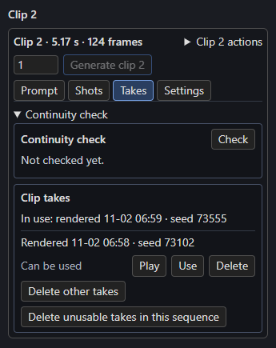

# Takes

Each new render of a clip moves the one before it into the sequence folder's `takes/`; a new render of a bridge does the same. The **Takes** tab plays them beside the take in use, puts one back without rendering, renders several at once and deletes the ones you don't need. A Timeline whose takes you never open renders exactly as before.

## The Takes section

Select a clip and open the **Takes** tab. A bridge before the clip has its own list under the bridge's panel, **Takes of the bridge before clip N**.

[{ align=right width=300 }](../assets/screens/takes.png)

The first line is the take in use, such as *In use: rendered 11-02 06:59 · seed 73555*. Then come the other takes, newest first, each with when it was rendered, its seed, whether it can be used, and **Play**, **Use** and **Delete**.

A take **can be used** when it fits the clip as it is now and both clips beside it, so that using it never makes a neighbour render again. Otherwise its row says why, from the first rule it fails:

| Line | Means |
| --- | --- |
| Can be used | Its seed on the clip makes the clip current, and it joins the clips on both sides. |
| Can't be used: its files are missing | Its video or latents are gone from its folder. |
| Can't be used: seed not recorded | Saved before takes recorded their seed. It can still be played and deleted. |
| Can't be used: it was rendered as box 4 | Made for another place: clips were added or removed before it. |
| Can't be used: the box changed after this take | Its prompt, length, cut, pictures, RefMods, guides, clips, timed text or memory changed. |
| Can't be used: the node's settings changed | Width, height, context, audio or reference size changed since. |
| Can't be used: a box it remembers has another take | A clip it remembers a frame of rendered again, or has another take in use. |
| Can't be used: the box before changed | It continued from the clip before, which now ends with other frames. |
| Can't be used: the box after changed | The clip after continued from this one, and this take ends with other frames. |

Joins are compared against the saved latents of the neighbouring clip, within 0.001. A take that carried no frames (a cut, or clip 1) has no join with the clip before.

## Using a take

**Use** puts the take in place: the take in use moves to `takes/`, the chosen take's files move back, and the clip gets the take's seed, as one undo step. **Nothing renders.**

Using a take can put other renders out of date, so **Use** lists them first and asks, for example "Boxes 7 and 9 remember a frame of box 3 and will need a new render." or "The bridge before box 4 will need a new render." **Use this take** goes ahead; **Cancel** keeps the take in use. Each take keeps its files' stamps, so switching back makes the others current again. Once every clip is done, the status rebuilds the [full video](../output/full-video-and-projects.md) with the chosen take.

## Compare takes

**Play** on a row shows that take in the Studio's player. **Switch** flips to the take in use at the same moment, playing or paused as it was, and back again, so two takes can be compared shot by shot.

## Make several takes

The number beside **Generate clip N** sets how many takes to render, from **1 to 10**. With 3 the button reads *Generate clip 2 · 3 takes* and queues three runs of that clip, one after another, each with a new seed. The last is in use when they finish, the others are listed under Takes, and the number goes back to 1. **Retake** on [the continuity check](check.md) renders one take.

## Delete takes

Each delete counts first and asks, for example "Delete 12 takes (1.4 GB)? This can't be undone."

- **Delete** on a row deletes that take.
- **Delete other takes** deletes every saved take of this clip, or this bridge, and keeps the take in use.
- **Delete unusable takes in this sequence** deletes every take that can't be used now, for any clip or bridge.

A deleted take is gone for good. The deletes never touch the take in use or anything outside `takes/`.

## While the sequence renders

While a run of this sequence is running or waiting in ComfyUI's queue, **Use** and the deletes are off ("Wait until this sequence's runs finish."), and nothing is put back. **Play** still works. Right after an edit they are also off until the Studio has read the new status.

## Undo, Redo and older workflows

Whenever the Timeline names a seed that a saved take fits, that take is put back. So **Ctrl+Z** after a **Use** or a render brings the earlier take back with its seed, **Ctrl+Y** brings the newer one back, and opening an older copy of the workflow does the same. Keep **one Timeline per sequence open**: two tabs or two nodes on the same sequence with different seeds each put back their own take, so the take in use can flip back and forth.

## Files

Takes live in `output/h3_sequences/<name>/takes/`, one folder each, named for the files' stem and when they moved there, for example `seg_0003_20261006-135000` or `bridge@<id>_20261006-135000`. The manifest lists them under `takes`.
