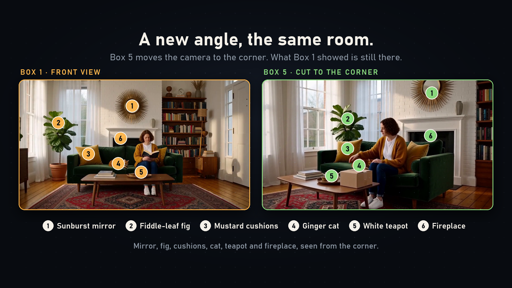
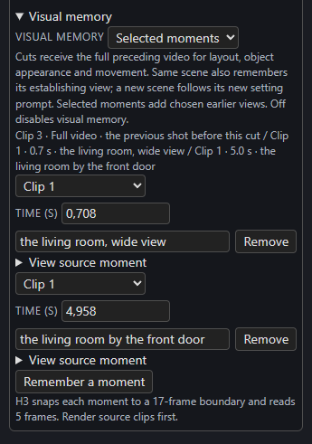

# Visual memory

When a film cuts to a new angle, H3 normally sees only the new prompt, so a room, a coat or a house can change. **Visual memory** shows H3 earlier moments of the film so a later clip keeps what they established.

*Left: the first clip's room. Right: a later clip from another camera angle, rendered with selected moments from the first clip.*

## How it works

Each remembered moment is a **five-frame** window read directly from a saved clip's original video latent and handed to H3 as a native video reference (`<Video N>` in the prompt). H3's text encoder sees a decoded presentation of it; the diffusion model receives the original latent without a pixel round trip. There is no extra model, dependency or patch. Memory is video only; `carry_audio` still owns seamless audio overlap.

At a **cut**, every enabled memory mode also supplies the **full preceding video's original latent**, so layout, object appearance and movement carry over while the next shot starts from a fresh target.

When someone speaks on either side of the cut, the full video is left out: H3 copies its lip movement onto the new shot, so the new clip's lines go out of sync. The clip remembers the five frames before the cut in its place. Speech here means a [dialogue cue](../sound/dialogue.md) that isn't all voiceover, or typed `<d>` lines.

## The four modes

Choose one in a clip's **Settings → Visual memory**.

[{ align=right width=300 }](../assets/screens/visual-memory.png)

| Mode | What the clip is shown |
| --- | --- |
| **Same scene** | The scene's establishing view and a midpoint from the preceding clip. A cut stays in the scene: it carries no frames, but it remembers the establishing view and the last five frames before the cut. This is the default for drawn and Story-planned clips. |
| **Selected moments** | Up to three views **you** choose, from any earlier clip, including across scenes, each with a description of the details to keep. |
| **Cast** | On a Timeline with a [Story bible](../story/cast.md): each scheduled character as they look *now*, and the place. |
| **Off** | No memory. The clip behaves as before. |

A cut marked **New scene** starts a new scene and keeps that visual history while letting the new prompt define the new setting. An appearance change also starts a new scene. When Story plans clips it marks new scenes for you.

## Selected moments, step by step

1. Select the **later** clip and open **Settings → Visual memory**; choose **Selected moments**.
2. Press **Remember a moment**. In the new row, pick the **earlier clip** and the **time** within its delivered footage. **View source moment** plays it.
3. Describe what matters, for example `red brick house, blue door, three upstairs windows`.
4. **Render the source clip first**. A clip whose source is missing, stale or incompatible stops with a clear "render the source first" message.

The panel lists the moments in force, for example *Clip 3 · Full video · the previous shot before this cut / Clip 1 · 0.7 s · the living room, wide view / Clip 1 · 5.0 s · the living room by the front door*, and reminds you that *H3 snaps each moment to a 17-frame boundary and reads 5 frames*. The window can therefore begin slightly before the time you picked. For a continuing source clip, the time refers to the delivered footage, and a window never starts inside the replayed overlap.

## What re-rendering does

Regenerating a clip that another clip remembers marks the dependent clip as **needing a render**, in both the status and the clip's tooltip, which says why.

## The bundled example

The repository's memory demo has six clips and one bridge: a detailed living room, a cut outside the house, a bridge to another porch view, a cut back inside using selected moments from the first clip, a corner view of the room, and a continuing reading shot whose own memory is **Off** because continuation already carries the clip before. [Reproduce it](https://github.com/KadoBOT/ComfyUI-H3-Continuity-Studio/blob/main/docs/MEMORY-DEMO.md) with `examples/memory_demo.json`; no uploaded references or credentials are needed. It was rendered at 1024 × 576, 24 fps, with 39 carried frames. Exact output depends on the weights, sampler and LoRAs, and fixed seeds do not guarantee identical output across setups.

!!! info "Validation boundary"
    Regression checks cover latent reuse, delivered-time offsets, cross-cut recall, source invalidation and the editor. The full renderer has not been visually benchmarked with every memory mode. A fair test renders the same seeds with memory off, automatic scene memory and a hand-picked view, then compares details, motion at the joins, runtime and VRAM.
