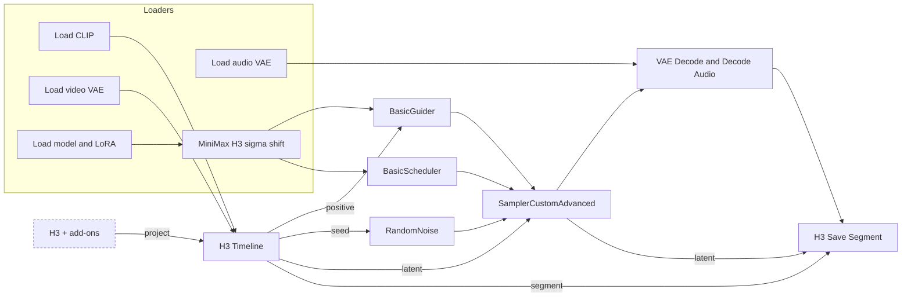
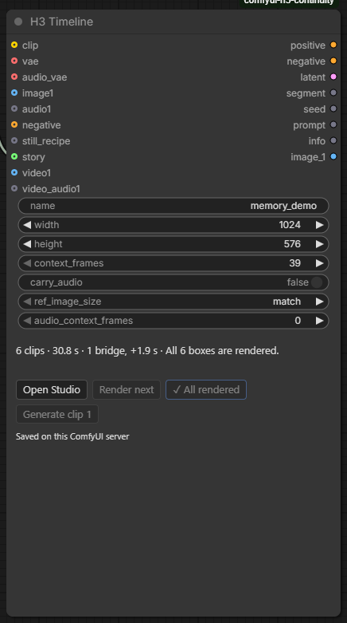

# Your first video

This page follows the **Hello H3** example step by step. You load one workflow, pick your model files and click one button. You get two clips where the second continues the first, joined into one video. You need no pictures, no audio and no language model.

## 1. Load Hello H3

Load `examples/v1/01-hello-h3.json` from the node pack through ComfyUI's workflow loader. A note on the left explains each step. The workflow holds the model loaders, one **H3 Timeline** node with two clips already written, ComfyUI's sampler, and **H3 Save Segment**.

## 2. Pick your model files

In the five loaders, select the H3 files installed on *your* machine:

| Loader | File the example was set up with |
| --- | --- |
| Load Diffusion Model | `fastvideo_fasth3_8step_v2_pruned_int8_convrot` (FastH3 8-step v2) |
| Load LoRA | `minimax_h3_ref2v_turbo_8step_v1.0_768p_comfyui_bf16` (8-step turbo LoRA) |
| Load CLIP | `qwen3vl_32b_minimax_h3_int8_convrot` |
| Load VAE (video) | `minimax_h3_video_vae_int8_convrot` |
| Load VAE (audio) | `minimax_h3_audio_vae_fp32` |

If the text encoder or a VAE is missing, ComfyUI offers to download it from [Comfy-Org/MiniMax-H3](https://huggingface.co/Comfy-Org/MiniMax-H3). The workflow names no download for the diffusion model and the LoRA, so select your own. With a different model or LoRA, set the scheduler's steps to what your LoRA expects.

!!! note "The red outlines"
    Until you pick models that you have installed, ComfyUI outlines the loader nodes in red. That is expected.

## 3. Click ▶ Render

Click **▶ Render** on the H3 Timeline node. It reads *▶ Render 2 remaining*. It queues one run per clip that is not rendered yet, here two, in order. Each run renders one clip. **H3 Save Segment** stores it under `output/h3_sequences/hello_h3/` and writes the full video when both clips are done.

## 4. Watch the join

Clip 2 **continues** clip 1. H3 starts clip 2 from the last 39 frames of clip 1 (`context_frames` on the Timeline), so the woman, her coat and the pier carry across the join at about 5 seconds.

Press **Open Studio** on the Timeline node. In the **Viewer**, play **Full video** and watch the join. If it isn't what you wanted, change clip 2's prompt or seed in the **Prompt** and **Settings** tabs and render it again. The earlier render is kept, so you lose nothing.

!!! tip "Start small"
    Short clips and enough GPU memory for your chosen model make the first loop fast. Generation quality and continuity vary with the model, inputs and settings, so inspect each join.

## 5. Add what you need

A fresh H3 Timeline shows only the core: clips, prompts, length, seed and the join choice. Everything else comes from a small node you plug in when you want it. Use **Add:** on the Timeline node, or the **Add to this Timeline** row at the bottom of the Studio. See [Add-on nodes](../build/add-ons.md). Each add-on has its own small example in `examples/v1/`.

## How the graph is wired

At its core the graph has two H3 Continuity nodes between ComfyUI's loaders and sampler:

- **H3 Timeline** takes the CLIP and the video VAE. It outputs the prompt conditioning, the empty latent to sample, the seed and a `segment` describing what this run is. Each run renders **the next clip that needs it**.
- The **sampler section** is ordinary ComfyUI: guider, scheduler, noise and sampler. The Timeline's `seed` output feeds the noise.
- **H3 Save Segment** stores each clip's video and latents under `output/h3_sequences/<name>/`, so the next clip can continue from them. When every clip is done, it also writes the full video.

## The Timeline node's settings

{ align=right width=300 }

| Setting | What it does |
| --- | --- |
| `name` | The sequence folder under `output/h3_sequences`. Use a different name per project. |
| `width`, `height` | Output size, in multiples of 32. |
| `context_frames` | Frames each clip carries from the one before it: **22** (0.9 s), **39** (1.6 s), **90** (3.75 s) or **141** (5.9 s). |
| `carry_audio`, `audio_context_frames` | Advanced. How the matching audio is carried. A connected **H3 + Sound** sets them. |
| `ref_image_size` | Advanced. Reference image sizing (`match` or `max`). A connected **H3 + References** sets it. |

Below the settings are the status line and the **Open Studio**, **Render next**, **▶ Render N remaining** and **Generate clip N** buttons. **Render next** renders only the next clip that needs it. ComfyUI's own **Run** button works too: every queued run renders the next clip that needs it.
