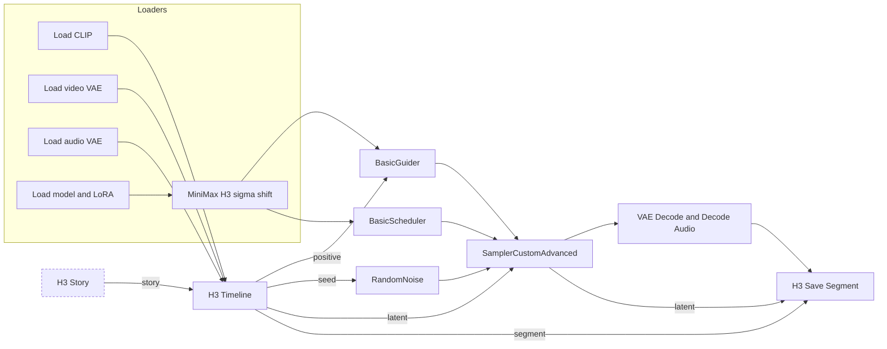

# Your first sequence

This walkthrough renders two clips and checks the join between them. Keep the clips short and the resolution modest the first time.

## 1. Load the example workflow

Load `examples/h3_story_studio.json` from the node pack through ComfyUI's workflow loader. Then, in the loader nodes, select the H3 **diffusion model**, **text encoder**, **video VAE**, **audio VAE** and optional **LoRA** that exist on *your* installation. The model names in the example come from its original environment, and nothing is downloaded for you.

!!! note "The red outlines"
    Until you pick models that you have installed, ComfyUI outlines the loader nodes in red. That is expected.

The example also contains an optional still-image subgraph (used to generate [first and last frame guides](../build/frame-guides.md)). It may need an extra model, but you can ignore it for video-only work.

## 2. Understand the wiring

At its core the graph has three H3 Continuity nodes between ComfyUI's loaders and sampler:

- **H3 Timeline** takes the CLIP and the two VAEs, and outputs the prompt conditioning, the empty latent to sample, the seed and a `segment` describing what this run is. Each run renders **the next clip that needs it**.
- The **sampler section** is ordinary ComfyUI: guider, scheduler, noise, sampler. The Timeline's `seed` output feeds the noise.
- **H3 Save Segment** stores the clip's video and its latents under `output/h3_sequences/<name>/` so that the next clip can continue from them. When every clip is done it also writes the full video.
- **H3 Story** is optional and only needed to [write prompts with a model](../story/writer.md). Renders never wait for it.

## 3. Set the Timeline node

The node's own widgets control the whole sequence:

{ align=right width=300 }

| Setting | What it does |
| --- | --- |
| `name` | The sequence folder under `output/h3_sequences`. Use a different name per project. |
| `width`, `height` | Output size, in multiples of 32. 1024 × 576 is a reasonable start. |
| `context_frames` | Frames each clip carries from the one before it: **22** (0.9 s), **39** (1.6 s), **90** (3.75 s) or **141** (5.9 s). |
| `carry_audio` | Also carry and freeze the matching audio. |
| `ref_image_size` | Reference image sizing, as in the native H3 Reference to Video node (`match` or `max`). |
| `audio_context_frames` | Incoming audio context in 24 fps frames; `0` follows the video context. |

The status line (for example *6 clips · 30.8 s · 1 bridge, +1.9 s · All 6 boxes are rendered.*) and the **Open Studio**, **Render next**, **Render N remaining** and **Generate clip N** buttons sit underneath.

## 4. Draw the first two clips

1. Press **Open Studio** on the Timeline node.
2. Press **+ Clip** in the Timeline toolbar at the bottom (or drag after the last clip to draw one). Write a prompt in the **Prompt** tab on the right.
3. Add a second clip. In its **Settings** tab, leave the join on **Continue** so it carries the first clip's last frames, or tick **Cut** for a new camera angle. See [Joins and bridges](../continuity/joins-and-bridges.md).

Everything you do in the Studio is saved in the Timeline node, so it saves with the workflow.

## 5. Render

- **Render next** renders the next clip that needs it.
- **Render N remaining** renders everything that is not current, in order.
- **Generate clip N** (in the clip panel) renders just that clip. The number beside it sets how many [takes](../continuity/takes.md) to make.

You can also queue the workflow with ComfyUI's own **Run** button; every queued run renders the next clip that needs it.

## 6. Inspect the join

Open the **Viewer** and play **Clip 2 · active take**, then **Full video** once both clips are done. If the join is not what you wanted, change the prompt, the seed or the [join type](../continuity/joins-and-bridges.md), and render that clip again. The earlier render is kept as a [take](../continuity/takes.md), so you lose nothing.

!!! tip "Start small"
    Short clips and enough GPU memory for your chosen model make the first loop fast. Generation quality and continuity vary with the model, inputs and settings, so inspect each join.
