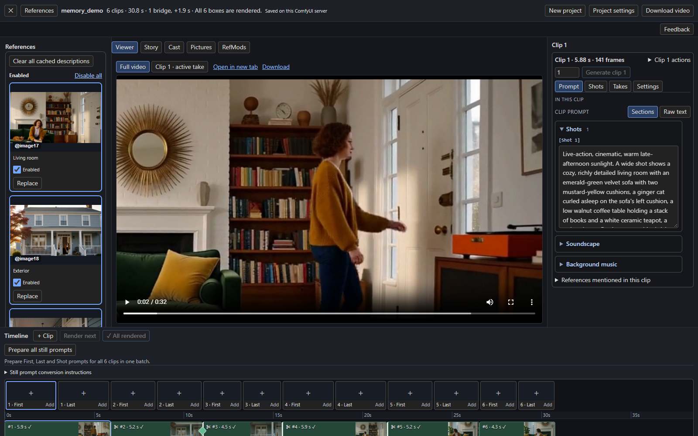
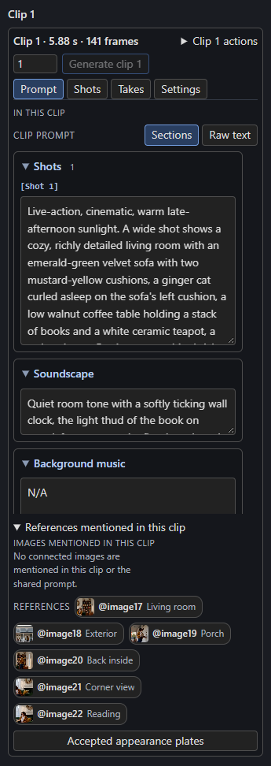
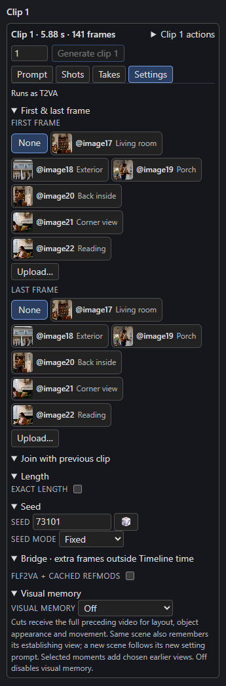
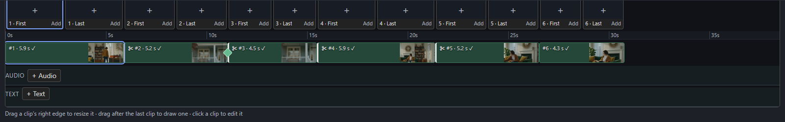

# The Studio tour

Press **Open Studio** on the Timeline (or Story) node. The Studio fills the window; **✕** at the top left closes it and returns to the graph. **Esc** also closes it.

This tour shows **Full** mode, with every feature. A new Timeline starts in **Guided** mode and shows only the parts whose [add-on nodes](../build/add-ons.md) are connected; **Show all features** in the top bar switches to Full.

## Top bar

| Control | What it does |
| --- | --- |
| **✕** | Close the Studio. |
| **References** | Show or hide the left-hand references column. |
| *Project name and status* | The sequence name, the clip count and length, bridges and the render state ("All 6 boxes are rendered."). |
| **Undo / Redo** | Step backward or forward through Timeline edits. |
| **History** | Open the list of edits and jump directly to any retained state. |
| **New project** | Start a fresh project in this workflow. See [Full video and projects](../output/full-video-and-projects.md). |
| **Project settings** | Shared prompt, settings for [long continuing chains](../continuity/long-chains.md#in-the-studio), and export or import of the project. |
| **Download video** | Save the full video (enabled once every clip is rendered). |
| **Revise story** | Open the Story page at its feedback field to [patch a written story](../story/writer.md#editing-a-written-story). |

## Left: References

Every picture the Timeline knows about, with its `@imageN` name, a thumbnail, an **Enabled** switch and **Replace**. Turn a picture off and H3 no longer sees it. Details in [References and pictures](../build/references.md).

## Centre: pages

| Page | Use it to |
| --- | --- |
| **Viewer** | Play the **Full video** or a single clip's take. **Open in new tab** and **Download** are next to the switch. |
| **Story** | [Write the story](../story/writer.md): idea, template, scope, advanced model settings and feedback. |
| **Cast** | Build and edit the [Story bible](../story/cast.md): characters, places, props and looks. |
| **Pictures** | Upload [pictures into the Timeline](../build/references.md#pictures-saved-in-the-timeline). |
| **RefMods** | Manage reusable reference modifiers. See the note below. |

!!! note "RefMods"
    RefMods are references stored as encoded H3 conditioning instead of pixels. The RefMods page lists them and needs the companion **ComfyUI-MiniMaxH3Mod** node pack (its numbered RefMod encoder); without it the page says to install it. They share the Timeline's reference slots, and a Timeline picture cannot take a RefMod's slot. This guide does not cover RefMods in depth.

## Right: the clip panel

The panel follows the selected clip. Its header shows the clip number, length and frame count, a **Clip N actions** menu (move earlier or later, **Duplicate**, **Delete**), the number of takes to make and **Generate clip N**.

[{ width=240 }](../assets/screens/clip-prompt.png)
[{ width=240 }](../assets/screens/clip-settings.png)

| Tab | Contents |
| --- | --- |
| **Prompt** | The clip's prompt as **Sections** or **Raw text**, plus the references it mentions. See [Writing prompts](../build/prompts.md). |
| **Shots** | The First, Last and timed-shot guide images. See [First and last frames](../build/frame-guides.md). |
| **Takes** | The continuity check and saved takes. See [Takes](../continuity/takes.md) and [The continuity check](../continuity/check.md). |
| **Settings** | First and last frame, join, length, seed, bridge and visual memory. See [Timeline and clips](../build/timeline.md). |

## Bottom: the Timeline

From top to bottom: the toolbar (**+ Clip**, **Render next**, **Render N remaining**, **Prepare all still prompts**), a **First** and **Last** marker for each clip, the time ruler, the clip track, an **AUDIO** lane and a **TEXT** lane.

- Each clip shows its number, length and render state (a ✓ once rendered, a thumbnail of its last frame).
- A **✂** marks a clip that cuts. The green diamond on a join is a [bridge](../continuity/joins-and-bridges.md#bridges).
- Drag a clip's right edge to resize it, or drag after the last clip to draw a new one. Click a clip to edit it.
- **+ Audio** and **+ Text** add [audio](../sound/audio.md) and [timed text](../sound/timed-text.md).

## Undo, redo and history

Press **Undo** to reverse the last Timeline edit, or **Redo** to restore it. Outside a text field, **Ctrl+Z** (Mac: **Cmd+Z**) undoes; **Ctrl+Y** or **Ctrl+Shift+Z** (Mac: **Cmd+Shift+Z**) redoes. Text fields keep their own typing undo.

**History** lists named states such as *Add clip*, *Edit clip 2 prompt* and *Change width*. Select a row to restore that point, including all intervening edits. The current state is marked; later states remain available until you make a new edit, which replaces that later branch. Typing during one visit to a field is grouped as one edit, and a drag is one edit.

The latest **100 edits** are kept for each Timeline during the current session. Closing and reopening Studio keeps them; loading a different project, reloading the workflow or refreshing the page starts a new history. On a phone, the controls are under **More**.

History restores Timeline content (clips, prompts, guides, Cast, pictures, references, audio and text) and the Timeline's size/context settings through normal autosave. Writer results applied to the Timeline are included. Independent Story-node inputs and graph wiring keep their existing ComfyUI behavior. History does not cancel jobs, erase rendered files or recover permanently deleted files; live job receipts continue following the server.
