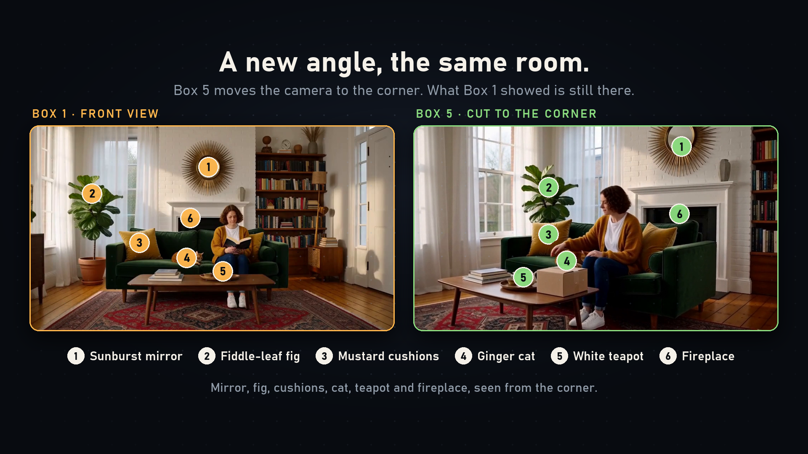
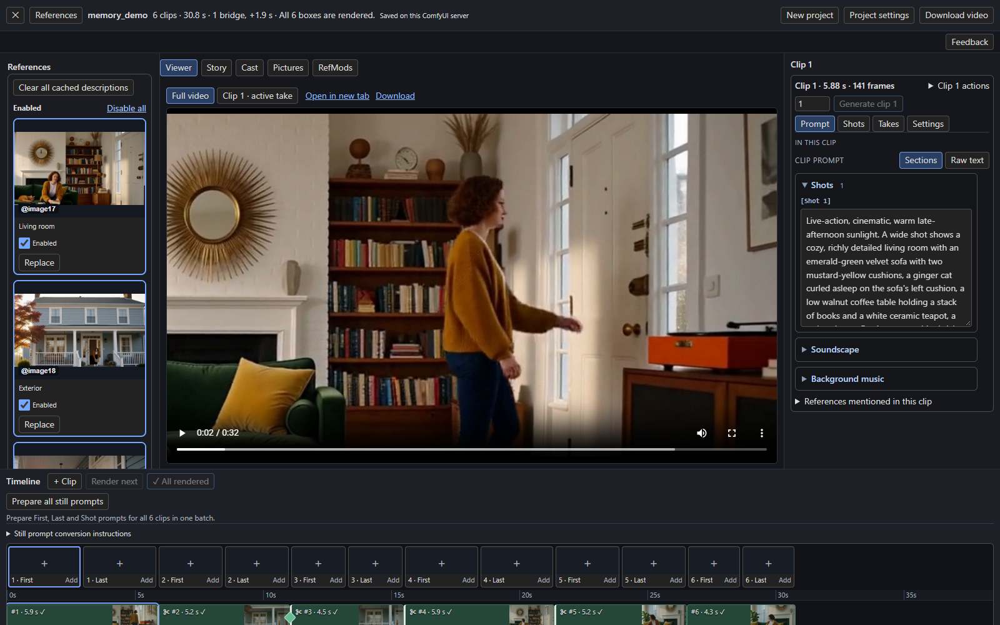

# H3 Continuity

**Author and render multi-shot sequences with MiniMax H3 in ComfyUI, and keep people, clothes and places consistent across cuts.**

H3 Continuity is a ComfyUI custom node pack. You lay a film out as **clips** on a **Timeline**; each clip is one H3 generation. Clips can continue the one before, cut to a new angle, start a new scene, or be joined by a generated **bridge**. A **Studio** editor gives you the viewer, prompts, pictures, takes and checks in one place, and an optional **H3 Story** writer can plan the whole Timeline from an idea.

{ .off-glb }

*Left: the room the first clip established. Right: the same room from a new camera angle, rendered with visual memory.*

[Get started](getting-started/index.md){ .md-button .md-button--primary }
[Watch the demo](https://github.com/KadoBOT/ComfyUI-H3-Continuity-Studio/releases/tag/v0.1.0){ .md-button }
[Reproduce the example](https://github.com/KadoBOT/ComfyUI-H3-Continuity-Studio/blob/main/docs/MEMORY-DEMO.md){ .md-button }

## What you can do

-   :material-timeline-outline: **Draw the film as clips**

    ---

    Add, resize, split and reorder clips, choose how each one joins the one before, and render them one at a time or all at once.

    [:octicons-arrow-right-24: Timeline and clips](build/timeline.md)

-   :material-brain: **Remember what came before**

    ---

    Bring chosen moments from earlier clips into a later shot, so a room, a coat or a house survives a cut or a new camera angle.

    [:octicons-arrow-right-24: Visual memory](continuity/visual-memory.md)

-   :material-transit-connection-variant: **Join clips four ways**

    ---

    Continue, cut, start a new scene, or insert a generated bridge that moves from one shot to the next without re-rendering either.

    [:octicons-arrow-right-24: Joins and bridges](continuity/joins-and-bridges.md)

-   :material-image-multiple: **Guide shots with pictures**

    ---

    Mention references with `@image1`, pin a first or last frame, and generate or upload still guides for any clip.

    [:octicons-arrow-right-24: References and pictures](build/references.md)

-   :material-history: **Keep every take**

    ---

    Each re-render keeps the earlier take. Play, compare, put one back, or render several takes of a clip at once.

    [:octicons-arrow-right-24: Takes](continuity/takes.md)

-   :material-check-decagram: **Check what rendered**

    ---

    Have a vision model compare each rendered clip with your characters, places and the clip before it, and measure colour drift.

    [:octicons-arrow-right-24: The continuity check](continuity/check.md)

-   :material-pencil-box-multiple: **Write the story with a model**

    ---

    Type an idea and **H3 Story** plans the clips and writes their prompts through any OpenAI-compatible endpoint, local or cloud.

    [:octicons-arrow-right-24: The H3 Story writer](story/writer.md)

-   :material-account-group: **Cast and the Story bible**

    ---

    Track characters, places and props with their looks over time, voice clips and pinned moments.

    [:octicons-arrow-right-24: Cast and the Story bible](story/cast.md)

-   :material-music-note: **Audio lanes and timed text**

    ---

    Place music and sound on lanes, and attach a Whisper transcript as exact on-screen lettering.

    [:octicons-arrow-right-24: Sound and text](sound/audio.md)

-   :material-api: **Drive it from code**

    ---

    A versioned HTTP API, a Python client and an agent skill let scripts and agents author and render a Timeline headlessly.

    [:octicons-arrow-right-24: Timeline HTTP API](automation/api.md)

## The Studio at a glance

The Studio opens from the **Open Studio** button on the Timeline node. It shows the full video or any clip's take, the clip's prompt and settings, your pictures, and the Timeline itself along the bottom. See [the Studio tour](getting-started/studio-tour.md).

!!! info "What you need"
    A current ComfyUI with working MiniMax H3 support and its model files, and a GPU for generation. H3 Continuity does not download models or provide credentials, and the optional Story writer needs a separately configured language-model endpoint. See [Install](getting-started/install.md).

!!! note "Quality is the model's, not a guarantee"
    Continuity features give H3 more to work with; they cannot promise a perfect result. Review each join and use [takes](continuity/takes.md) to retry. Each page notes what has and has not been verified.
