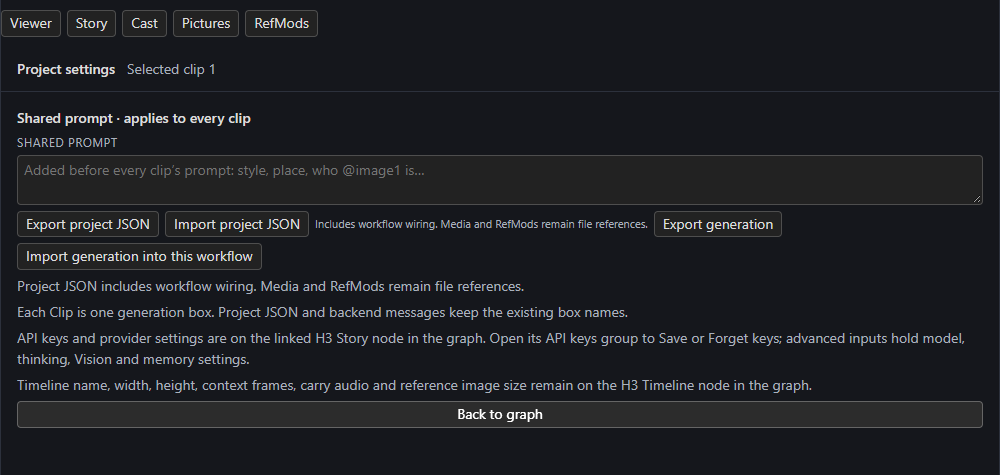
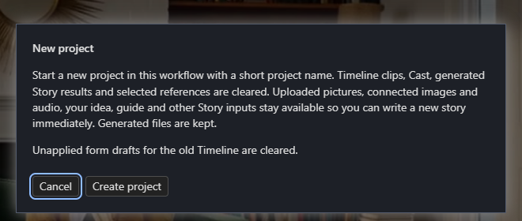

# Full video and projects

## The full video

When the last current clip finishes, **H3 Save Segment** assembles one MP4 from the saved clip videos in Timeline order. The Viewer's **Full video** plays it; **Open in new tab** opens the file and **Download** (or the top bar's **Download video**) saves it. It is stored under `output/h3_sequences/<name>/`.

- The full-video links appear only when **every current clip is rendered**. Editing the Timeline, changing render settings or re-rendering a clip invalidates the previous export, and reopening a completed Timeline recreates a missing or outdated file. Original segment videos and archived takes are preserved.
- Assembly copies compatible H.264 tracks and re-encodes on the CPU when encodings differ. All segments need the same size and frame rate; an incompatible or missing segment reports an export error instead of showing the older file.
- Saved clip MP4s already exclude carried context. Audio comes from the saved decoded waveforms with the usual context trimming and overlap fade. Connect decoded images and audio to **H3 Save Segment** to include them; export generates no transitions or new soundtrack.
- Rendered [bridges](../continuity/joins-and-bridges.md) are played between their clips, and ticked [audio clips](../sound/audio.md#in-the-full-video) replace H3's audio.
- A selected, current [replacement candidate](../continuity/joins-and-bridges.md#replacement-bridges) plays in place of the footage it replaces, so the video keeps its length. When the clip after it then starts partway into its file, assembly re-encodes instead of copying.

## Projects

Open **Project settings** in the Studio's top bar.

[](../assets/screens/project-settings.png)

| Control | Does |
| --- | --- |
| **Shared prompt** | Text added before every clip's prompt. |
| **Export project JSON** / **Import project JSON** | Move a complete workflow graph, including wiring. Media and RefMods stay as file references. |
| **Export generation** / **Import generation into this workflow** | Move the *generation* (Story, Timeline, accepted guides, candidates, native saved takes and sidecars) into another generator workflow while keeping that workflow's models, nodes and sampler. |
| **Back to graph** | Return to the Studio. |

Generation JSON references verified media in this installation; it contains no model weights and does not embed large videos or latents. Missing or changed media blocks an import. Import creates a *separate* sequence and never resumes a batch or replays source jobs. Use generation transfer to move work, for example, between a Qwen image workflow and the H3 video workflow, and project JSON to copy a whole graph.

API keys and provider settings live on the Story node, and the Timeline's name, width, height, context frames, carry audio and reference size stay on the Timeline node.

### New project

**New project** starts a fresh project in the current workflow.

[{ width=420 }](../assets/screens/new-project.png)

Timeline clips, Cast, generated Story results and selected references are cleared. Uploaded pictures, connected images and audio, your idea, guide and other Story inputs stay available so you can write a new story immediately. Generated files on disk are kept. Unapplied form drafts for the old Timeline are cleared.

## Folder layout

```text
output/h3_sequences/<name>/
  seg_0001.mp4          # a clip's video, without carried context
  seg_0001.safetensors  # its original audio+video latents
  seg_0001_last.png     # its last frame
  bridge@<id>.mp4       # a bridge's new frames (plus .safetensors, _last.png)
  replace@<id>-<n>.mp4  # a replacement candidate (plus _preview.mp4, _original.mp4)
  <name>_full.mp4       # the full video
  manifest.json
  checks.json           # only if you ran the continuity check
  takes/                # earlier renders, one folder each
```
