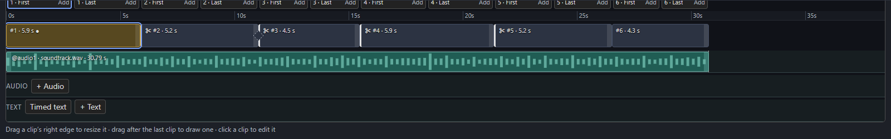
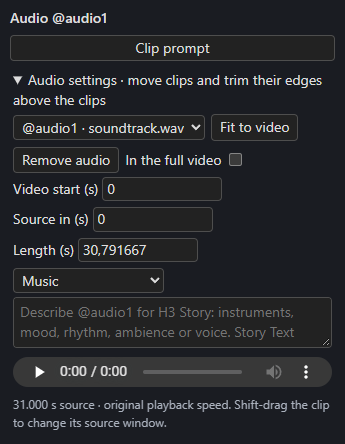

# Audio lanes

Place music, ambience and voice on **audio lanes** above the clips. H3 hears the part of each lane that covers a clip as a native audio reference, and you can optionally have the final video play your original recording instead of H3's generated audio.

## Add audio

In the Studio's Timeline, press **+ Audio** or drop an audio file on the AUDIO lane. Long files keep their original duration; the initial window fits the video when clips already exist.

[{ align=right width=300 }](../assets/screens/audio-settings.png)

- **Move** the clip to align it; **trim** either edge; **Fit to video** snaps it to the video. Playback speed never changes.
- **Shift-drag** selects a different source window without moving the clip.
- The clip shows the file's waveform. It is decoded in the browser once per file and session; until then the coarse saved outline shows.
- Select an audio lane, then use **Detect beats · @audio1** (or the selected lane's slot) in its **Audio settings** in the right-hand inspector. It analyses only that lane's file and draws beat ticks under its waveform. **Snap to beats**, beside it, lets a video clip's right edge land on the nearest detected beat within a few pixels; hold **Shift** to drag freely. A clip without [Exact length](../build/exact-lengths.md) still keeps a length on H3's frame grid, so it lands on the grid length nearest the beat. Beats are kept for the session only; detect another lane explicitly if you want its beats too, and detect again after reloading.
- The settings give exact **Video start (s)**, **Source in (s)** and **Length (s)**, and an audition player.
- Choose **Music**, **Overall soundscape** or **Shot audio / voice**, then describe the sound for the Story writer.

You can also connect Text to `descriptions.audio1`…`audio3` on the Story node; Story text takes precedence over the lane's own description. Write uses the descriptions in H3's matching audio sections and keeps the reference binding.

## How H3 hears it

Connect an **audio VAE** to the Timeline. Each covered clip receives the matching audio window as a native reference, and continuing clips include the replayed audio context so the reference follows the generated clip clock. Uncovered parts of a clip are silent in that reference; audio outside its placed interval is excluded. A short source is padded, never stretched or looped.

There are **three audio slots**, shared with connected audio references and audio RefMods. A Load Audio file can be placed directly; for computed audio, upload its source file to create a draggable lane. A [character's voice clip](../story/cast.md#voice-clips) has a slot of its own from `@audio4` up.

Placement, trim, waveform and descriptions persist with the Timeline. Uploaded files remain in `input/h3_audio`.

!!! note "Moving audio re-renders"
    Moving or trimming a clip that H3 hears makes the clips it covers need a render again.

## In the full video

H3 *generates* from the reference and prompt. To hear the uploaded file itself in the final video, tick **In the full video** in the clip's settings. It is off by default, and a clip from a connected Load Audio node needs its file uploaded first.

With at least one clip ticked, the full video plays **only** the ticked clips:

- each plays the source window its lane shows, from its video start, at original speed;
- overlapping clips add up, held within full scale;
- the video is silent where no ticked clip plays, and a clip past the last frame is cut there;
- the sample rate is the first ticked clip's (in slot order) and the audio is stereo if any ticked clip is;
- there are no fades.

The full video rebuilds on its own a moment after a ticked clip changes, with nothing re-rendered, and the Full video view names the clips it plays. Ticking never puts a rendered clip out of date. If a ticked clip's file is missing the full video isn't rebuilt and the Studio names the file. Clip and bridge takes keep H3's audio, and unticking every clip brings H3's audio back. With [inserted bridges](../continuity/joins-and-bridges.md#only-the-full-video-gets-longer), a ticked clip starts with its clip after the bridges before it, then plays straight through. [Replacement bridges](../continuity/joins-and-bridges.md#replacement-bridges) add no time, so a ticked clip plays at its own place across them.

## Lock audio to boxes

Turn on **Lock audio to boxes** in a lane's Audio settings to keep each existing box's current source range through later Timeline edits. It is off by default, independently for each lane. One recording supplies every segment; no audio files are cut and playback speed stays unchanged.

- The waveform separates at box boundaries. Selecting a segment auditions only its visible source range; outlined gaps contribute silence from that lane.
- Extending a box adds silence after its assigned range. Shortening hides its tail; extending again restores the hidden audio before adding silence. Other boxes retain their source ranges.
- Inserted, appended and duplicated boxes have no assigned audio. Moving a box carries its range; deleting removes its placement. Splitting divides the range, with the hidden tail belonging to the second half.
- Dialogue, audio-synced timed text and detected beats follow the assigned source ranges. Their words and original source timestamps do not change. Existing dialogue and lettering review checks still apply.
- Unlock before moving, trimming, fitting, slipping or replacing the recording. Descriptions and **In the full video** remain editable. Disabling a reference preserves its bindings.
- Unlocking restores the original continuous placement while keeping box edits. If playback would change, confirm before applying it. **Undo** restores the bindings and hidden tails; locking again captures fresh ranges.

Enabling does not change the audio you hear. Add boxes first; if an existing inserted bridge would change a selected soundtrack when locked, the setting identifies that bridge and stays off until you resolve it. An inserted bridge added after locking contributes silence from that lane. Existing sequence-clock lock restrictions still apply.

Silence is specific to this lane: other lanes keep playing. **In the full video** continues to choose whether the original recording plays; locking does not turn it on. An empty native reference does not guarantee that H3 generates silence. Source windows stay synchronized, but continuation, memory or changed replay can still make later takes outdated.

Saved workflows and checkpoints retain the bindings. Older readers stop with a request to update rather than silently play a continuous recording.

## Locked to the sequence clock

An uploaded clip's settings also have **Locked to the sequence clock**. A locked recording keeps its place in the full video: no bridge may add time across a cut inside it, so those cuts stay cuts and its dialogue stays in sync, and the Timeline names any bridge or setting that would move the picture away from it. Lock a recording when its words or beats must line up with the clips. See [Dialogue cues](dialogue.md#lock-a-recording).
