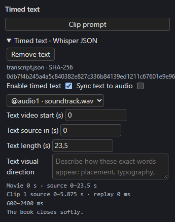

# Timed text

Attach a **Whisper-style transcript** and H3 is asked to show those exact phrases as on-screen lettering, at the right times. Spoken dialogue is separate: type it in `<d>…</d>` in the prompt, or keep it as [dialogue cues](dialogue.md) bound to the recording.

## Import a transcript

In the Studio's Timeline, press **+ Text** (or **+ Whisper JSON**) and choose a local JSON file. Supported shapes are Whisper `segments` (optionally with word timings), `chunks` with two-value timestamps, `words`, or a raw timing array. Phrases, Unicode, whitespace and word precision stay exact.

The browser parses the file locally and hashes its original bytes; **it does not upload the transcript**. An import error leaves the previous attachment intact. H3 control tokens such as `<d>`, `<|…|>`, `<scenetrans>` and `<cutoff>` cannot appear inside literal phrases or words.

[{ align=right width=300 }](../assets/screens/timed-text-settings.png)

## Settings

Select the **Timed text** clip on the TEXT lane to open **Timed text · Whisper JSON**:

| Control | Does |
| --- | --- |
| **Enable timed text** / **Remove text** | Turn the attachment on or remove it. |
| **Sync text to audio** | Drive the text clock from an audio lane. |
| *Audio lane picker* | Which lane the text follows. A missing lane stays selected and shows an inline message. |
| **Text video start (s)**, **Text source in (s)**, **Text length (s)** | Independent timing, available while sync is off. Imported text starts independent. |
| **Text visual direction** | Describe the lettering's typography, placement and motion. |

While **synced**, the chosen lane's live placement and source window drive the text. Moving or trimming audio never rewrites transcript timestamps: source-in 30 with movie start 0 places source cue 30 at movie 0. Turning sync off copies the current resolved clock. Disabling audio conditioning does not disable the text clock.

The panel prints the clock it resolved, for example *Movie 0 s · source 0–23.5 s; Clip 1 source 0–5.875 s · replay 0 ms; 600–2400 ms: The book closes softly.* It shows the selected clip's source window, local cue milliseconds, carried replay, and continuing and replay-only phrases at 24 fps.

A cue that continues past the end of a clip keeps its lettering through the final generated frame. Under the **Prompt** tab, **Effective H3 prompt and text window** shows the final prompt and projected window. Editing text refreshes render status and saved state; it **does not start Story writers**. Clips whose effective text changes become out of date.

## Guides and lettering contracts

A saved guide or plate can carry a lettering contract (`visible_text` and `text_contract`) recording the literal phrases and direction active where the image applies. Editing the timed text never rewrites a saved contract. Before rendering, the backend compares each contract with the text now active and stops with *timed text changed; restore the text or remove this lettering image* when they differ. Images without a contract aren't checked.

!!! warning "Inspect the result"
    Cue intervals are native H3 prompting requests. Check actual spelling, onset, clearing and continuity in the render: the model can miss those requests even when the clocks and frame counts pass.
