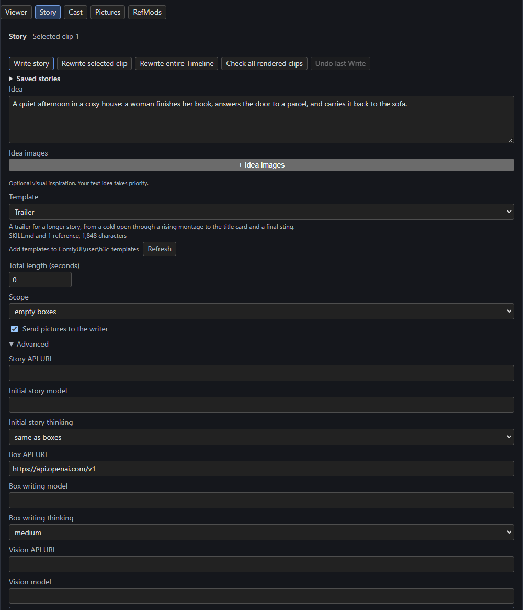

# Templates

A **template** is a video you want yours to resemble, written as text: its sequence, its style and its rules. Pick one on the Story page, and Write shapes the plan after it and stages every clip in its style. Your idea still says what the video is *about*: the template's own characters, names, places and words are only examples.

## Pick a template

On the Studio's **Story** page, the **Template** row follows **Idea**.

[](../assets/screens/story-template.png)

The list has **None**, then your templates grouped by subfolder, then **Examples**. Under it, the row shows the template's description and what it loads, for example *SKILL.md and 1 reference, 1,848 characters*, plus any references it skipped, a note when its front matter couldn't be read, and a problem when Write would refuse it. The last line names your template folder, with **Refresh** for files you add while the page is open.

The choice is saved with the workflow as the Story node's `template` setting. **Export story** keeps the choice but not the template's files.

## Your template folder

Templates live in ComfyUI's user folder, in `h3c_templates` (for example `ComfyUI/user/h3c_templates`). H3 creates the folder when the Story page first lists it.

- **A single file**: any `.md` file is a template. Its id is its path in the folder, such as `night.md` or `ads/night.md`.
- **A skill**: a folder containing a `SKILL.md` (any letter case) is one template. Its id is the folder's path, and its other files are references that `SKILL.md` can load.

Subfolders group the list (up to 8 levels deep; names starting with `.` are skipped). Junctions and symlinks are followed, so you can bring in templates you keep elsewhere without copying them.

## Front matter

A template can start with a front matter block giving its name and description (YAML, so JSON works too):

```yaml
---
name: Trailer
description: A trailer for a longer story.
---
```

Without it, the name is the file's name without `.md`, or the skill's folder name. Write never sends the front matter.

## A skill's references

A skill sends its `SKILL.md`, then each file it refers to in the order first mentioned, each after a line such as `File references/sequence.md:`. References are:

- a Markdown link's target, such as `[the sequence](references/sequence.md)`;
- a file name in backticks, such as `` `steps.md` ``;
- a `skill://<name>/<path>` address.

Only `.md`, `.txt`, `.json`, `.yaml` and `.yml` files load, each once. Web links and `#` anchors aren't references. A reference that is absolute, uses `..`, doesn't exist, isn't UTF-8 or has another extension is skipped, and the row lists it after *Not loaded:*. References inside referenced files aren't followed.

## Limits

A template's whole text, with its references, can have up to **100,000 characters**, read as UTF-8 (with or without a BOM). A template that is too long, or whose files aren't UTF-8, shows its problem in the row and Write refuses it.

## The examples

The list's **Examples** ship with H3 from its `examples/templates` folder and are read-only. To change one, copy it into your folder and edit the copy.

- **Music video**: performance and story intercut over the song's sections, cut on the beat.
- **Trailer**: a skill whose `SKILL.md` gives the style and rules and whose `references/sequence.md` gives the sequence, from the cold open to the final sting.

## What Write does with a template

Write reads the template when it starts, so edits reach the next Write.

- **The planner** spreads the template's sequence over the clips in order, stretching or repeating it to fill them. The template's own length is not the video's.
- **Each clip writer** (Write and **Rewrite selected clip**) stages its part in the template's look, camera, editing rhythm, transitions, typography and sound.
- **Story feedback** and **Update prose** keep revised clips in the template's style.

When instructions conflict, the template ranks **after everything you wrote**. Without a bible, the Guide and your idea win; with a [Story bible](cast.md), the planner follows the Guide, then the idea, the bible, the template and last its planning rules. A plan made with a template is planned again when the template's text changes. The Vision check, Build bible, bridge prompts and Prepare don't use it.

## A missing template

If the saved template is no longer in the list (renamed, deleted, or a story from another PC), the row shows `<id> (missing)`. Write, Rewrite, feedback and Update prose refuse it before sending anything, naming the template and folder. Put the file back or choose another template or **None**.
