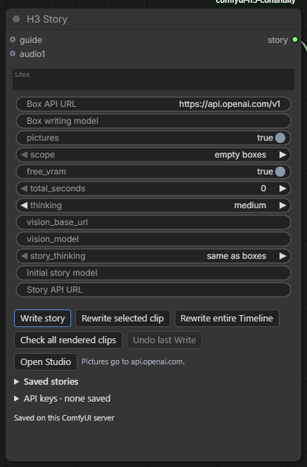
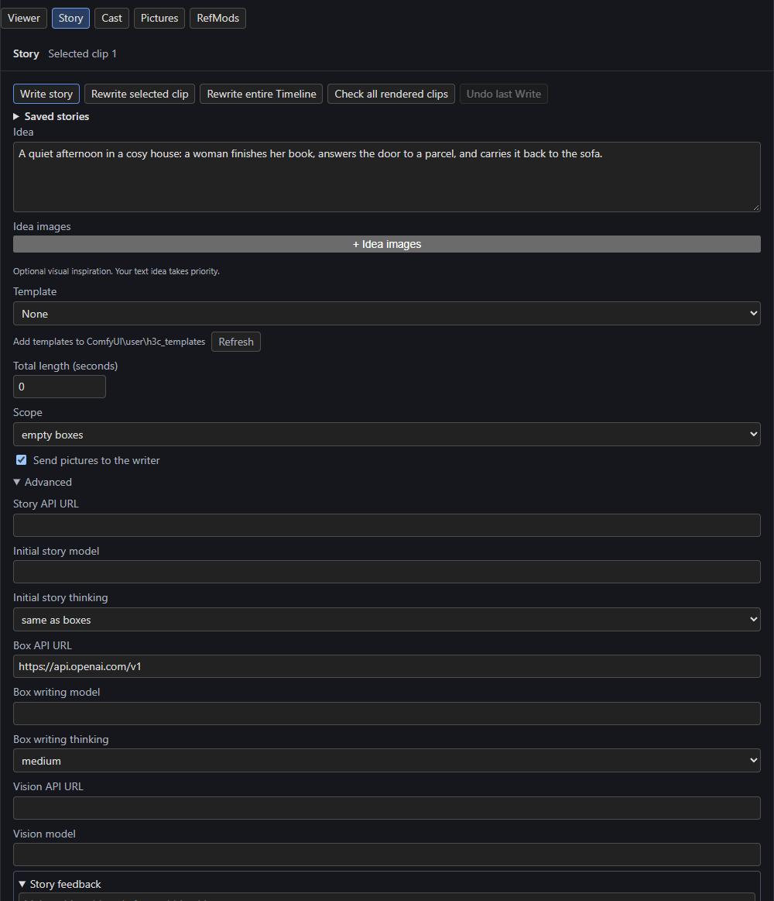

# The H3 Story writer

Type an idea and press **Write story**: a model on any **OpenAI-compatible API** plans the story and writes the prompts of the linked Timeline's clips. On an empty Timeline it plans the clips too.

## Connect it

Link **H3 Story**'s `story` output to the Timeline's `story` input. That is all: renders never wait for the Story node. The node's own buttons mirror the Studio's Story page.

[{ align=right width=260 }](../assets/screens/story-node.png)

| Setting | Meaning |
| --- | --- |
| **Box API URL** (`base_url`) | An OpenAI-compatible endpoint such as `http://localhost:1234/v1` for LM Studio. Also used for the initial story when **Story API URL** is empty. |
| **Box writing model** (`model`) | Model ID for clip prompts and revisions. Creative-writing or roleplay models that follow structured output can write vivid action and dialogue. |
| `pictures` | **Send pictures to the writer**: the model describes pictures that have no description and then sees them. Off: a configured Vision model supplies descriptions instead. |
| `scope` | Write only **empty boxes**, or also boxes that still hold what Write wrote. |
| `total_seconds` | How long the story runs when Write plans an empty Timeline. `0` lets the model choose, up to 60 s. |
| `thinking` | Reasoning effort for clip prompts and revisions: off, minimal, low, medium, high, xhigh, max. Off sends `reasoning_effort: none`. Choose a level your API supports. |
| `free_vram` | When the model server runs on this PC, Write takes a turn in ComfyUI's queue, frees ComfyUI's models while it writes and unloads the model afterwards. |
| `guide` (input) | Creative requirements checked against the final prompts. Link Text or any string node. |

**Advanced** (a closed group on the Studio's Story page, and the node's advanced inputs) holds the rest: **Story API URL**, **Initial story model** and **Initial story thinking** for the planning step (a strong reasoning model suits plot and pacing; **same as boxes** keeps old workflows unchanged), plus **Vision API URL** and **Vision model**.

**API keys** are saved per host in the node's closed **API keys** section, on the ComfyUI server. They are never in your workflow.

## Write a story

1. Open the **Story** page in the Studio.
2. Write your **Idea**. Optionally add **Idea images** (see below), pick a **Template** ([Templates](templates.md)) and a **Total length**.
3. Press **Write story**.

Fast writing makes one planning request and then one structured request per clip, using the API's JSON schema, so the model returns data and **code compiles it** into H3 prompt syntax. That keeps shot times consistent, inserts spoken dialogue verbatim, and refuses plans that need more time than a clip has instead of accelerating them. Invalid or truncated replies stay as expandable drafts in the Story panel and never replace a prompt.

| Button | Does |
| --- | --- |
| **Write story** | Plans and writes (a new Timeline), or writes clips in scope. |
| **Rewrite selected clip** | Rewrites only the selected clip, keeping its place in the saved story and its neighbours fixed. |
| **Rewrite entire Timeline** | Rewrites every clip. |
| **Check all rendered clips** | Runs the [continuity check](../continuity/check.md). |
| **Undo last Write** | Puts the Timeline back as it was before the last Write, where you haven't changed things since. |
| **Saved stories** | Every story written on this server, in two lists: pick a **story**, then one of its **versions** (newest first, numbered from v1). Saved entries with the same title, ignoring case, spacing and a trailing revision tag such as ` · r2`, are versions of one story. **Load version** puts the selected version into the Timeline; the version open in this workflow is marked *open now*. **Delete version** removes only that version. **Rename story** shows a name of your choosing in place of the title (empty goes back to the title), and **Delete story** removes every version after one confirmation. |

Progress shows in the Story panel and the Studio's top bar; a Write that fails or is cancelled **keeps the clips it finished**.

### Idea images

**+ Idea images** accepts any number of pictures beside the text idea. The writer (or a Vision model) describes each whole image. Descriptions accompany the idea in planning and writing; explicit text and the Guide take priority. A planner may use an image as optional guidance for palette, texture, lighting or composition. The writer states those contributions separately from the cast and never asks H3 to reproduce the image. Only images a prompt actually uses are saved as Timeline pictures and count towards H3's nine-image limit; the rest remain creative context.

### Reference pictures

With **Send pictures to the writer** on, the model describes any connected or uploaded picture that has no description, then sees the pictures while planning. Descriptions are cached against the actual image and reused until it changes. **Clear all cached descriptions** (References pane) forgets them. A configured Vision model must describe a requested image successfully before the writer starts; provider failures stop the job and show the image, model and error.

### Audio and video descriptions

Connect Text nodes to `descriptions.audio1`, `descriptions.audio2`, `descriptions.audio3` (and the video inputs) to describe reference audio or video for the writer. Story text takes precedence over an audio lane's own description.

## Editing a written story

Select the clip and press **Revise story** in the Studio's top bar; the Story page opens at the feedback field. Enter a change such as *After stubbing his toe, make Subject 1 kneel.* **Apply feedback** asks the writer to patch the current story while preserving unrelated text, timing and clips. Progress and **Undo** are in the top bar.

- Patches are validated before publication; a patch that would break the source publishes nothing.
- Text you edit by hand while the writer works is preserved, with a note naming the skipped update.
- With a [Story bible](cast.md), feedback patches the *source* of each clip written from it, and the clip is compiled again from it so later Cast edits keep the change.

## Writing guidance built in

The writer's instructions favour **short, independently editable clips**, even for a continuous take. Internal `[Shot N]` stages give distinct actions their own timing; the plan records `cut` and only `true` inserts a camera cut. A continuing clip starts from the pose and motion actually reached. Appearance is read-only for clip writers: change a look on the Cast page first. Sound is chosen by typed kinds, loudness and quality, and code builds the audio sentences.

!!! note "Quality is the model's"
    These checks establish that the instructions and compiler are wired correctly. Whether the written clips render well still needs you to review the generated video.
